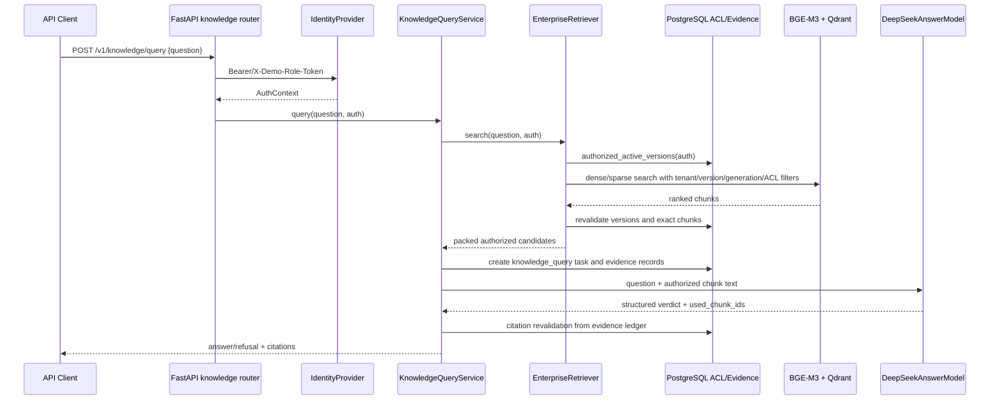
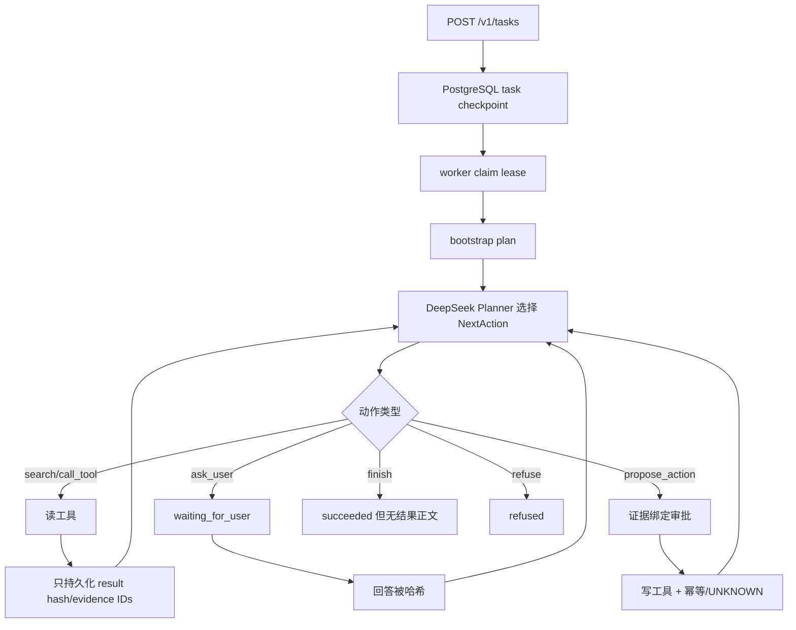
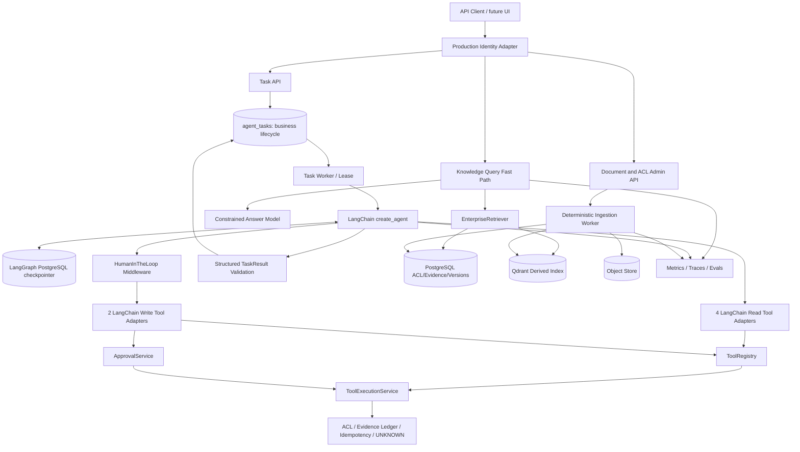

# 企业知识任务 Agent 工程案例、现状评估与重构计划

> - 审查日期：2026-08-25
> - 迁移决策同步：2026-08-25；当前代码尚未实施本计划中的 LangChain 主运行时
> - 审查范围：当前工作区源码、配置、迁移、冻结语料、测试与历史验收产物；外部项目的 GitHub 仓库和官方文档
> - 结论置信度：静态代码链路为高；当前运行状态为低到中，因为本机缺少 `pytest`，且未启动 PostgreSQL、Qdrant、BGE-M3、Docling 或 DeepSeek 做实时端到端验证

## 0. Agent 开发工程师求职导读

本节用于快速说明项目价值和工程边界。仓库中存在的实现不等于候选人独立完成的内容，求职时应按实际职责说明个人贡献。

### 0.1 项目定位

> **基于 FastAPI、PostgreSQL、Qdrant、DeepSeek 和 LangChain `create_agent` 的企业知识任务 Agent：复用成熟 RAG、ACL、证据与受控工具能力，以 PostgreSQL checkpointer 提供可恢复执行。**

当前可稳定陈述的是“完整 RAG 主链 + 待替换的自定义 Agent Runtime 原型”。只有完成 M1 的 `create_agent` 只读研究闭环并通过真实 E2E 后，才适合将它描述为“受权限和证据约束的可恢复企业知识任务 Agent”；M2 完成后再加入受双层审批约束的写工具能力。

### 0.2 30 秒项目介绍

项目首先解决企业 RAG 中最容易被忽略的工程问题：租户与 ACL 过滤、活动版本约束、证据账本、引用复核，以及可恢复的文档摄取。迁移前任务系统用 `NextAction`、`TaskRuntime`、租约与 CAS 构造了自定义循环，但工具正文、用户澄清和最终结果没有闭合。目标方案不继续扩展这套循环，而是一次性切换到 LangChain `create_agent`：框架负责模型消息、工具循环、线程短期记忆、检查点、中间件和人工中断；现有应用继续负责 ACL、证据、工具 Schema、审批、幂等、UNKNOWN 和最终引用复核。

### 0.3 仓库可证明的能力边界

| 层级 | 当前能力 | 求职陈述边界 |
|---|---|---|
| 代码已闭环 | 授权检索、证据入账、受约束生成、引用复核、文档摄取与恢复 | 可作为企业 RAG 工程能力主线；当前工作树仍需实时 E2E 复验 |
| 迁移前原型 | 结构化 Planner 动作、持久任务状态、工具 Schema、权限、预算、审批、幂等和 UNKNOWN 副作用边界 | 可讲现状和取舍，不应宣称真实多步任务已端到端通过 |
| M1 待完成 | `create_agent`、PostgreSQL checkpointer、4 个只读工具、线程短期记忆、结构化 `TaskResult` 和真实 Research E2E | 完成并验证后才升级为 Agent 核心成果 |
| M2 待完成 | 2 个写工具、LangChain HITL 与 `ApprovalService` 双层审批、产物读取和副作用恢复 | 完成后才陈述受控写入能力 |
| 明确非目标 | 多 Agent、任意 MCP、Shell/代码执行、跨线程长期记忆、自定义插件平台 | 没有业务证据前不实现，体现边界判断而非能力缺失 |

### 0.4 最值得面试展开的工程点

1. **框架只替换执行支架。** `create_agent` 负责消息、工具循环、结构化结果和线程恢复，不替代 ACL、证据、审批或业务事务。
2. **执行状态只有一个事实源。** LangGraph PostgreSQL checkpointer 保存消息、工具调用、Todo、中断和恢复点；`agent_tasks` 只保存业务生命周期、所有者、租约、中断摘要和最终结果。
3. **上下文工程通过 ToolMessage 闭环。** 工具返回经过 Schema 校验、字段裁剪和长度限制的业务内容，而不是只向下一轮模型提供 hash 和 evidence ID。
4. **副作用安全由服务端保证。** 模型不能授予权限；写工具由 Schema、审批、evidence binding、幂等键和 UNKNOWN fail-closed 共同约束。
5. **双层审批不是让框架决定权限。** LangChain HITL 只负责暂停与恢复，`ApprovalService` 继续绑定身份、工具版本、参数、证据、过期时间和副作用状态。
6. **RAG 与 Agent 分流。** 单次事实问答继续走低延迟 RAG；只有多文档研究、版本比较和受控写入进入 Agent。
7. **评估结果和执行轨迹。** 除最终答案外，还检查工具选择、证据增长、权限、预算、checkpoint 恢复、审批和停止原因。

### 0.5 演示路径

**当前代码具备、待环境复验的 RAG 演示链：**

1. 上传企业文档并轮询摄取状态。
2. 以授权身份查询，展示回答和由证据账本构造的可复核引用。
3. 以未授权身份查询同一问题，证明过滤发生在检索阶段而不是回答后遮盖。
4. 注入摄取失败或 worker 重启，展示租约、世代和恢复边界。

**M1 完成后的只读 Agent 主演示：**

```text
目标：比较采购制度 V1 与 V2，并回答主要变化
  -> create_agent 选择授权检索工具
  -> ToolExecutionService 执行搜索和版本读取
  -> 裁剪后的工具正文通过 ToolMessage 进入下一轮
  -> Agent 调用确定性版本比较工具
  -> 结构化 TaskResult 候选经 Evidence Ledger 复核后交付
  -> worker 重启后从同一 PostgreSQL checkpoint 恢复
```

M1 验收必须展示至少两轮 Agent/工具交互、完整但受限的工具内容、一次崩溃恢复和最终引用。M2 再单独展示 `create_report_artifact` 或 `create_work_item_draft` 被 LangChain HITL 暂停、经 `ApprovalService` 批准后恢复执行；只展示一次工具调用不算 Agent 演示。

### 0.6 推荐阅读顺序

| 阅读目标 | 章节 |
|---|---|
| 1 分钟判断项目定位 | 第 0-1 章 |
| 理解真实执行链和根因 | 第 3-4 章 |
| 展开 `create_agent`、checkpointer、上下文和工具安全 | 第 6 章 |
| 说明最小落地顺序 | 第 7 章 P0、M1、M2 |
| 展示工程验证能力 | 第 11 章 |
| 深挖外部选型、迁移和风险 | 第 5、8-10、12-14 章 |

## 1. 项目现状结论

### 1.1 一句话结论

按产品完整性分类，当前项目整体最接近 **RAG Chatbot**；按 Agent 工程求职视角，更准确的描述是：

> **一个单轮、带企业 ACL 和证据账本的 RAG 问答后端，附带一个具备持久状态、工具、审批和恢复协议，但尚未打通语义结果闭环的半自动 Agent 骨架。**

它不是严格意义上的聊天机器人，因为没有对话线程、消息历史、流式输出或聊天前端；它也还不能按整个产品认定为 Agent 系统，因为通用任务链路无法把完整工具结果和用户澄清送回 Planner，也不能向调用方交付研究结果或产物正文。

### 1.2 分类判断

| 候选分类 | 判断 | 依据 |
|---|---|---|
| Chatbot | 否 | 只有单个 `question` 字段；未发现 conversation/thread/message、历史消息、SSE 或 WebSocket，见 `src/rag_kb/web/schemas/query.py:4-7` |
| RAG Chatbot | **整体最接近** | `/v1/knowledge/query` 已形成授权检索、证据入账、受约束生成和引用复核的完整可消费链路，见 `src/rag_kb/application/query_service.py:84-182` |
| Workflow 应用 | 部分符合 | 文档摄取和通用任务都采用确定性状态与 worker，但业务问答主链不是预定义业务工作流 |
| 半自动 Agent | **迁移前任务原型** | Planner 能选择下一动作，存在工具、循环、状态、预算和审批；但结果回灌、澄清和最终交付断裂 |
| Agent 系统 | 否 | 缺少可用的“观察 -> 决策 -> 执行 -> 新观察 -> 最终结果”语义闭环和真实端到端评估 |

### 1.3 量化评估

评分定义：`0` 为不存在，`1` 为仅有接口或概念，`2` 为局部实现但不可形成可靠闭环，`3` 为可用但工程能力不完整，`4` 为较成熟，`5` 为生产级且经过充分验证。

| 维度 | 分数 | 证据与说明 |
|---|---:|---|
| 对话能力 | 1/5 | 单轮问答可用；无会话、历史、消息模型和流式响应，`src/rag_kb/web/schemas/query.py:4-7` |
| 知识检索能力 | 4/5 | 有租户、ACL、活动版本、投影世代、Qdrant 预过滤、SQL 精确复核、证据账本和引用复核，`src/rag_kb/application/enterprise_retriever.py:115-202`；真实脏语料和实时 E2E 仍不足 |
| 任务规划能力 | 2/5 | DeepSeek 输出严格 `NextAction`，但 Planner 看不到计划步骤和完整工具内容，`src/rag_kb/infrastructure/llm/task_planner.py:75-123` |
| 任务拆解能力 | 1/5 | `UpdatePlanAction.steps` 会持久化，但未发现计划步骤送入 Planner 或 `current_step` 正常推进，`src/rag_kb/domain/tasks.py:68-71` |
| 工具调用能力 | 2/5 | 6 个服务端注册工具、输入输出 Schema、权限、超时和审批协议已存在；工具结果只留下哈希引用，`src/rag_kb/application/task_worker.py:293-328` |
| 多步骤执行能力 | 2/5 | worker 可重复领取并推进状态图，但下一轮模型看不到关键观察内容，无法可靠完成研究任务 |
| 状态管理能力 | 4/5 | PostgreSQL 持久状态、状态版本、租约 generation、CAS、pending action、预算和事件较完整，`src/rag_kb/domain/tasks.py:136-165` |
| 长期记忆能力 | 0/5 | 未发现跨任务、跨会话的用户事实或偏好记忆；任务检查点不等同于长期记忆 |
| 失败恢复能力 | 3/5 | 摄取链有租约心跳、重试、世代和清理恢复；任务链有检查点和幂等，但读工具结果不可恢复、任务租约无后台心跳 |
| 人工确认和权限控制 | 3/5 | ACL、写工具强制审批和 evidence binding 较强；公开 API 无法发现待审批 ID，且当前仅有演示身份 Provider |
| 可观测性 | 2/5 | 有稳定错误码、任务事件、run/trace ID 和安全日志；无集中指标、分布式追踪、告警、真实 token/cost 计量 |
| Agent 评估能力 | 1/5 | 有 20 个确定性协议模拟和 2 次真实 Planner 单步调用，但没有真实多步 Agent E2E，`src/rag_kb/evaluation/task_acceptance.py:1-5` |

不汇总总分：长期记忆和多 Agent 等能力是当前阶段的明确非目标，简单相加会掩盖“结果不可交付、观察不可回灌”这两个真正的 Agent 阻断项。

### 1.4 是否需要重构成 Agent

不应把整个系统都重构成 Agent。应保留两条明确路径：

| 场景 | 应采用的形态 | 原因 |
|---|---|---|
| “某制度规定是什么” | 现有单次 RAG 快速路径 | 一次授权检索和一次受约束生成即可，Agent 循环只会增加延迟、成本和不确定性 |
| 多文档研究、版本比较、形成带引用报告 | 有界 Research Agent | 需要多次检索、比较、证据聚合和结果生成 |
| 创建报告、工作项草稿等内部副作用 | 有审批的 Controlled Action Agent | 需要权限、证据绑定、人工确认、幂等和结果复核 |
| 文档上传、摄取、索引和删除 | 确定性 Workflow | 数据一致性任务不应交给 LLM 规划 |
| ACL、身份同步、删除和版本切换 | 确定性服务与数据库约束 | 安全与一致性规则不能由模型决定 |

不应把整个系统都框架化：RAG 快速路径、摄取、ACL 和数据一致性继续保持确定性。只替换任务子系统的 Agent 执行支架，以 LangChain `create_agent` 和 LangGraph PostgreSQL checkpointer 取代自定义 Planner/Runtime 循环，并复用现有服务端安全边界。

## 2. Chatbot 与 Agent 的判定依据

### 2.1 判定标准

本报告将“Agent”定义为同时满足以下门槛的系统，而不是只要用了 LLM 或工具调用就算 Agent：

| 门槛 | 当前状态 |
|---|---|
| 模型可在受控范围内选择下一动作 | 已具备：`DeepSeekTaskPlanner.next_action` |
| 至少一个真实工具可被服务端校验并执行 | 已具备：`ToolRegistry` 与 `ToolExecutionService` |
| 工具结果以可理解内容返回后续决策 | **未具备**：只保留引用哈希和 evidence ID |
| 可进行两步以上执行并根据观察调整 | 结构存在，语义闭环未通过 |
| 有显式状态、停止条件和资源预算 | 已具备大部分 |
| 可交付可消费的最终结果 | **未具备**：`FinishAction` 没有答案正文 |
| 失败、重启和副作用可安全恢复 | 部分具备 |
| 权限和人工审批不由模型自行授予 | 已具备大部分 |
| 有真实轨迹和任务成功率评估 | **未具备** |

### 2.2 为什么主路径更像 RAG 应用

1. 请求模型只有 `question`，见 `src/rag_kb/web/schemas/query.py:4-7`。
2. HTTP 入口直接调用 `KnowledgeQueryService.query`，见 `src/rag_kb/web/routers/knowledge.py:16-22`。
3. `KnowledgeQueryService.query` 固定执行一次检索、一次证据入账、一次模型回答和一次引用复核，见 `src/rag_kb/application/query_service.py:84-182`。
4. 模型只能基于已提供上下文回答并选择 chunk ID，不能选择是否调用工具或安排下一步，见 `src/rag_kb/answerer.py:31-39,70-78`。
5. 未发现会话线程、聊天历史、流式响应、会话摘要或跨轮记忆。
6. 因此完整且可消费的产品能力是单轮 RAG，而不是多步骤 Agent。

### 2.3 已具备的 Agent 特征

| 能力 | 代码证据 | 当前价值 |
|---|---|---|
| 结构化下一动作 | `SearchAction`、`CallToolAction`、`AskUserAction`、`UpdatePlanAction`、`ProposeAction`、`FinishAction`，`src/rag_kb/domain/tasks.py:48-103` | 避免解析自由文本命令 |
| 显式状态图 | `TaskNode`，`src/rag_kb/domain/tasks.py:28-41` | 可审计、可验证转移 |
| 持久任务状态 | `TaskState` 和 `AgentTaskRow` | 支持跨进程恢复 |
| 模型决策 | `DeepSeekTaskPlanner.next_action`，`src/rag_kb/infrastructure/llm/task_planner.py:75-123` | 模型可在 Schema 内选择动作 |
| 服务端工具注册 | 4 个读工具、2 个写工具，`src/rag_kb/application/tool_registry.py:143-280` | 权限、风险和 Schema 由服务端控制 |
| 有界执行 | 模型、工具、重规划、时间和上下文预算，`src/rag_kb/domain/tasks.py:125-133` | 防止无限循环和成本失控 |
| 人工审批 | 写工具 `ApprovalPolicy.ALWAYS`，计划与证据摘要绑定 | 模型不能绕过审批直接写入 |
| 幂等与副作用安全 | tool call idempotency、UNKNOWN 状态、pending action 恢复边界 | 降低重复副作用风险 |
| 事件与追踪 | task events、run/trace ID、稳定错误码 | 为审计和调试提供基础 |

### 2.4 缺少的关键 Agent 能力

| 缺口 | 直接证据 | 后果 |
|---|---|---|
| 工具内容回灌 | worker 只提取 `evidence_ids`，`src/rag_kb/application/task_worker.py:317-328`；运行时只追加 `{"ref": ...}`，`src/rag_kb/application/task_runtime.py:288-300` | Planner 看不到搜索正文、版本比较结果或失败详情 |
| 用户澄清可读载荷 | API 把回答立即哈希，`src/rag_kb/web/routers/tasks.py:97-114` | 暂停后继续时模型不知道用户回答了什么 |
| 最终结果模型 | `FinishAction` 仅有 `supported_claim_ids`，`src/rag_kb/domain/tasks.py:82-85` | 任务成功但调用方拿不到答案 |
| 计划驱动执行 | Planner 请求只含 revision 和 current step，`src/rag_kb/infrastructure/llm/task_planner.py:78-96` | 计划更像审计记录，不是控制结构 |
| 工具失败反馈 | 读工具 `failed/unknown` 仍被记录成普通 result reference | 模型可能把依赖故障误判为“没有证据” |
| 可用审批发现 | 审批接口要求客户端提供 ID，但 `TaskResponse` 不返回 pending approval，`src/rag_kb/web/schemas/tasks.py:37-51` | 公开 API 无法闭环审批 |
| 结果和产物读取 | 只有产物清单，没有内容读取端点，`src/rag_kb/web/routers/tasks.py:196-215` | 创建报告后无法交付 |
| 长期记忆 | 未发现相关模型和生命周期 | 无法跨会话记住偏好；当前也没有已确认业务需求 |
| 真实 Agent 评估 | 真实 smoke 只调用 Planner 两次，`scripts/smoke_real_task_planner.py:28-80` | 无法证明多步成功率、恢复和安全性 |

## 3. 当前架构和请求链路（迁移前）

### 3.1 运行组件

| 层级 | 组件 | 作用 | 证据 |
|---|---|---|---|
| API | FastAPI | 健康检查、知识问答、文档、任务接口 | `src/rag_kb/web/app.py:11-18` |
| 生成 | DeepSeek via LangChain | 结构化问答与任务下一动作 | `src/rag_kb/answerer.py:51-78`、`src/rag_kb/infrastructure/llm/task_planner.py:36-73` |
| 检索 | BGE-M3 + Qdrant | dense 检索；可选自定义 sparse + RRF | `src/rag_kb/embedder.py`、`src/rag_kb/application/enterprise_retriever.py` |
| 事实源 | PostgreSQL + Alembic | 身份、ACL、文档、版本、chunk 元数据、任务、证据、审批、产物 | `migrations/versions/20260822_0001_enterprise_core.py` 至 `20260824_0009_queue_indexes.py` |
| 原文/动作载荷 | LocalObjectStore | 原始文档、pending action 和产物对象 | `src/rag_kb/infrastructure/object_store.py` |
| 摄取 | worker + Docling | 文档解析、切块、嵌入、投影发布和恢复 | `src/rag_kb/application/ingestion_worker.py:526-755` |
| 任务 | 单个 worker + 自定义状态机 | 领取任务、规划、调用工具、审批、恢复 | `src/rag_kb/application/task_worker.py:82-166` |
| 部署 | Docker Compose | PostgreSQL、Qdrant、迁移、初始化、API、worker | `docker-compose.yml:12-109` |

未发现独立前端。当前用户交互面主要是 HTTP API 和 FastAPI `/docs`。

### 3.2 真实知识问答调用链



关键事实：

1. 入口由 `rag_kb.main:app` -> `create_application` -> `create_app` 组装，见 `src/rag_kb/main.py:3-5`、`src/rag_kb/bootstrap.py:8-9`。
2. 身份由服务端 Provider 解析，不接受请求体自报角色，见 `src/rag_kb/web/dependencies.py:183-209`。
3. 服务组合根构造 BGE-M3、Qdrant、数据库授权端口、EnterpriseRetriever 和 DeepSeek，见 `src/rag_kb/web/dependencies.py:123-152`。
4. 检索先从 PostgreSQL 获得活动授权版本，再将 tenant、version、projection generation 和 principals 下推 Qdrant，见 `src/rag_kb/application/enterprise_retriever.py:115-158`。
5. 候选返回后执行版本和 chunk 精确复核，且校验正文 hash，见 `src/rag_kb/application/enterprise_retriever.py:165-221`。
6. 模型输出不能直接构造 Citation；应用层从证据账本再次校验并组装，见 `src/rag_kb/application/query_service.py:137-182`。
7. 失败采用 fail-closed，但检索故障和证据不足都可能通过 HTTP 200 的 refusal 表达，客户端必须读取 `refusal.kind`。

### 3.3 文档摄取调用链


当前优势：

- 上传不是伪装成跨 PostgreSQL/对象存储事务，而是显式预留和恢复，`src/rag_kb/application/document_service.py:138-198`。
- 摄取有 300 秒租约、后台心跳、默认 3 次尝试、30 秒延迟和投影清理，`src/rag_kb/application/ingestion_worker.py:472-550`。
- Qdrant 是派生投影，PostgreSQL 是业务事实源；版本和 generation 绑定可阻止旧投影复活。

### 3.4 待替换的当前通用任务链路



控制协议较强，但图中的三处数据丢失使它不能形成真实 Agent 产品：工具正文丢失、用户回答正文丢失、最终答案缺失。

### 3.5 Prompt 组织

| Prompt | 位置 | 主要约束 | 问题 |
|---|---|---|---|
| 知识回答 System Prompt | `src/rag_kb/answerer.py:31-39` | 只用授权上下文、证据不足拒答、忽略文档内指令、只选真实 chunk ID | 约束合理；尚无 claim-level entailment 评估 |
| 任务 Planner System Prompt | `src/rag_kb/infrastructure/llm/task_planner.py:15-21` | 结构化动作、工具/观察不可信、写操作审批、证据不足不编造 | 约束合理；输入数据被过度删减，Prompt 无法弥补数据缺失 |

Prompt 不应成为权限、审批、ACL、幂等或输入校验的事实源；当前这些边界大多正确地保留在服务端。

## 4. 现有问题清单

### 4.1 最高优先级问题

| ID | 严重度 | 问题 | 代码证据 | 影响 |
|---|---|---|---|---|
| A-01 | P0 | 工具结果未进入 Planner 上下文 | `task_worker.py:317-328` 只取 evidence IDs；`task_runtime.py:291-300` 只存 `ref`；`task_planner.py:125-137` 只允许极少摘要字段 | Agent 无法阅读检索正文、版本列表、比较结果和错误详情 |
| A-02 | P0 | 用户澄清答案不可恢复地哈希 | `web/routers/tasks.py:105-113`、`task_repository.py:577-620` | `waiting_for_user` 协议存在，但恢复后模型不知道答案 |
| A-03 | P0 | Research 任务没有最终结果 | `FinishAction` 只有 evidence IDs，`domain/tasks.py:82-85`；`TaskResponse` 无 result，`web/schemas/tasks.py:37-51` | 调用方只看到 `succeeded`，看不到研究结论 |
| A-04 | P0 | 公开审批和产物 API 不闭环 | task response 不暴露待审批 ID；产物只可列举不可读取，`web/routers/tasks.py:165-215` | 人工审批和报告交付无法仅靠公开 API 完成 |
| A-05 | P0 | `/v1/tasks` 接受永远不会由通用 worker 执行的 `knowledge_query` | 请求接受所有 `TaskMode`，`web/schemas/tasks.py:11-15`；claim 时排除，`task_repository.py:188-213` | API 返回 202 后任务永久不运行 |

### 4.2 Agent 与状态问题

| ID | 严重度 | 问题 | 说明 |
|---|---|---|---|
| A-06 | P1 | 计划未真正驱动执行 | revision 和 steps 会保存，但 Planner 输入没有 steps，且未发现 `current_step` 递增路径 |
| A-07 | P1 | 读工具失败被折叠成普通观察 | `ToolExecutionService` 会返回 failed/unknown，`task_worker.py:309-328` 只特殊处理写工具 unknown |
| A-08 | P1 | 幂等恢复丢失读工具结果 | `ToolCallRow` 只有 `result_hash`，`models.py:645-667`；幂等命中不返回原 result，`tool_execution_service.py:193-237` |
| A-09 | P1 | 多个预算字段没有真实计量 | `current_step`、`consecutive_failures`、LLM token usage 没有可靠更新；Provider 内部 retry 也可能不等于模型调用计数 |
| A-10 | P1 | task worker 租约没有摄取 worker 同等的后台心跳 | 长工具或模型调用可能跨过 60 秒 lease；摄取链已有可复用的心跳思路 |
| A-11 | P2 | 两套 Agent/RAG 遗留路径并存 | 活跃生产路径是 `EnterpriseRetriever` 和自定义任务状态机；`skills/policy_comparison.py` 仍有 LangChain `create_agent`，旧 `Retriever/ChunkStore/Lifecycle` 仍被部分测试使用 |

A-01 至 A-11 是迁移前现状证据，不再作为继续扩展旧 Planner/Runtime 的增量修复清单。新方案必须用结构化 ToolMessage、PostgreSQL checkpointer、`TaskResult` 和唯一 `create_agent` 入口消除这些断点；切换发布不并行保留旧任务循环。

### 4.3 知识库和语料问题

| ID | 严重度 | 问题 | 说明 |
|---|---|---|---|
| K-01 | P1 | 公开 API 无文档版本更新入口 | 内部 `register_upload(expect_existing=True)` 支持更新，`document_service.py:105-116`；HTTP POST 未传该参数，`web/routers/documents.py:53-73` |
| K-02 | P1 | 无 ACL grant/revoke 管理闭环 | HTTP 上传默认只为创建者建立权限；冻结 manifest 的 `allowed_roles` 主要用于 benchmark，不是生产管理面 |
| K-03 | P2 | 清洗和切分过于简单 | Markdown 只处理 `#`、`##` 和逐行 trim，`ingestion.py:58-75`；默认按 800 字符，无 token 感知和 overlap |
| K-04 | P2 | 扫描 PDF 不支持 | Docling 显式 `do_ocr=False`，`ingestion.py:88-105`；这是合理 MVP 限制，但必须在产品约束中公开 |
| K-05 | P2 | 缺少摄取质量报告 | 未记录页眉页脚、空表格、解析警告、OCR 需要、重复内容、chunk 长度分布等质量指标 |
| K-06 | P2 | 冻结测试语料不代表真实企业语料 | `data/corpus/manifest.yaml:1-4` 明确是自造模拟内容；不能证明扫描件、复杂表格、附件和脏数据质量 |

### 4.4 安全、部署和运维问题

| ID | 严重度 | 问题 | 说明 |
|---|---|---|---|
| S-01 | 生产 P0 | 当前唯一身份实现是演示 token | `DemoTokenIdentityProvider`，`infrastructure/auth/providers.py:23-53`；生产需 OIDC/JWT 或可信网关身份 |
| S-02 | P0 | 演示身份初始化和任务身份冻结不一致 | Provider attributes 含 permissions，`providers.py:10-16,36-43`；使用指南写入 `{}`，`使用指南.md:91-97`；worker 会做完整摘要比对，`task_execution.py:61-76` |
| S-03 | 生产 P0 | PostgreSQL/Qdrant 直接映射宿主机且 Qdrant 无认证 | `docker-compose.yml:19-20,33-35`；Qdrant payload 包含 chunk 正文，绕过 API 可绕过 ACL |
| S-04 | P1 | Compose 配置传播不完整 | API/worker 没有显式传递 model/base URL、检索参数和 embedding dim；`EMBEDDING_DIM` 只传给 init 可能造成维度漂移 |
| S-05 | P1 | 无 CI、静态检查和依赖安全门禁 | 未发现 `.github/workflows`、ruff、mypy、coverage、Bandit 或依赖扫描配置 |
| S-06 | P2 | 可观测性不足 | 无 Prometheus/OpenTelemetry、队列积压、worker 心跳、P95/P99、token/cost、告警和集中追踪 |
| S-07 | P2 | readiness 范围不完整 | 当前只查 PostgreSQL、Qdrant schema 和 projection convergence，`web/dependencies.py:54-103`；不查对象存储、模型缓存、worker 和队列积压 |
| S-08 | P2 | 缺少备份恢复和数据保留演练 | 未发现 PostgreSQL、Qdrant、对象存储的一致性备份、恢复 RTO/RPO 或灾难演练文档 |

### 4.5 测试可信度问题

| 事实 | 结论 |
|---|---|
| 当前有 56 个 `tests/test_*.py` 文件 | 单元和组件测试数量较多，覆盖面较广 |
| `docs/acceptance/latest.json:29-39` 记录 340 total、334 passed、6 skipped | 这是历史证据，不是本次审查运行结果 |
| 历史报告绑定 revision `320fd876...`，`docs/acceptance/latest.json:3-8` | 不能直接证明当前工作树通过 |
| 真实模型部分仅 2 次 Planner 调用，`docs/acceptance/latest.json:6456-6480` | 没有覆盖真实工具、恢复、审批、最终结果和完整 HTTP 链 |
| 任务验收明确不访问模型、网络、数据库或写工具，`evaluation/task_acceptance.py:1-5` | 它验证协议样例，不验证生产 Agent 数据流 |
| 本次执行 `python -m pytest` 失败：当前 Python 环境未安装 pytest | 当前测试状态仍未验证；本次没有为了报告擅自安装依赖 |

## 5. GitHub 类似项目调研

调研时间为 2026-08-25。以下信息以公开 GitHub 仓库和官方文档为准；官方案例和厂商陈述不等同于独立第三方生产验证，本报告不引用未经核验的 Star 数、性能数字或客户收益。

### 5.1 LangChain `create_agent` 与 LangGraph

- GitHub：<https://github.com/langchain-ai/langgraph>
- 官方文档：<https://docs.langchain.com/oss/python/langgraph/overview>
- 持久化：<https://docs.langchain.com/oss/python/langgraph/persistence>
- LangChain Agent 文档：<https://docs.langchain.com/oss/python/langchain/agents>
- 主要问题：快速构建有状态、可中断和可恢复的工具调用 Agent。
- 核心架构：LangChain `create_agent` 提供模型/工具循环和中间件接口，底层 LangGraph 提供状态图、Checkpointer 和中断恢复。
- Agent：本项目使用 `create_agent`，不自行搭建通用图或插件框架。
- RAG：通常把现有检索函数包装为节点或工具，框架本身不替代检索质量。
- 工具：可结合 LangChain tools/ToolNode，但权限和业务校验仍需应用实现。
- 记忆：Checkpointer 是线程内短期状态；Store 是跨线程长期数据。官方文档明确区分两者。
- 采用能力：`create_agent`、结构化响应、线程短期记忆、PostgreSQL checkpointer、中间件、模型/工具调用限制和 Human-in-the-loop。
- 应用保留能力：ACL、Evidence Ledger、`ToolRegistry`、`ToolExecutionService`、`ApprovalService`、幂等、UNKNOWN 和引用复核继续由现有代码负责。
- 双状态源规避：LangGraph PostgreSQL checkpointer 是 Agent 执行状态唯一事实源；`agent_tasks` 收缩为业务生命周期、所有者、租约、中断摘要和最终结果，不复制消息、工具循环或中断载荷。
- 长短期记忆边界：Checkpointer 保存单线程短期状态；跨线程 Store/向量记忆属于后续能力，首阶段不实现。
- 公开使用证据：官方仓库链接到 Built with LangGraph 案例集合，并列出 Klarna、Replit、Elastic 等；这些是厂商整理材料，本报告未独立验证其生产指标。

### 5.2 Dify

- GitHub：<https://github.com/langgenius/dify>
- 官方文档：<https://docs.dify.ai/en/self-host/use-dify/build/workflow-chatflow>
- 主要问题：让团队以可视化方式构建 Workflow、Chatflow、RAG、Agent 和工具应用，并提供运营界面。
- 核心架构：画布节点、模型节点、知识检索节点、工具节点、条件和变量；Workflow 一次运行，Chatflow 增加会话层。
- Agent：支持 Function Calling、ReAct 等 Agent 节点。
- RAG：内置知识库与检索节点。
- 工具：内置、插件和自定义工具。
- 记忆：以会话变量和聊天上下文为主，不应直接等同于治理完善的跨会话长期记忆。
- 值得借鉴：每步运行可视化、Prompt/模型配置集中管理、业务人员可观察运行日志。
- 不宜照搬：当前项目只需要一个受控后端，不需要同时引入完整前端、插件生态和第二套工作流事实源；许可证包含基于 Apache 2.0 的附加条件，商业部署必须单独审查。
- 对本项目的启发：借鉴“每步可观察”和“Workflow 与 Chatflow 明确分型”，不迁移平台。只有业务团队明确需要无代码编排时再评估。
- 公开使用证据：官方文档提供客服机器人等完整教程，但本次未核验到可独立验证的客户生产案例，因此不将教程表述为生产证明。

### 5.3 RAGFlow

- GitHub：<https://github.com/infiniflow/ragflow>
- Agent 官方文档：<https://ragflow.io/docs/v0.27.0/agent_overview>
- 主要问题：复杂文档理解、可配置摄取、混合检索、引用和 Agentic RAG。
- 核心架构：文档解析/切分/索引层，检索与引用层，可视化 Agent 流程层。
- Agent：画布组件支持条件、分类、循环、HTTP、数据库、MCP 和自定义代码。
- RAG：复杂格式解析、模板化切分、混合召回、融合重排和可追溯引用是其重点。
- 工具：内置组件和 MCP。
- 记忆：官方提供独立 Memory 能力；启用前仍需要权限、保留和删除治理。
- 值得借鉴：解析、切分、索引、检索分别可观察；复杂 PDF/表格采用专门策略；引用回到页码和结构位置。
- 不宜照搬：官方自托管栈明显重于本项目；不应一次替换 Docling、Qdrant、摄取、检索和 Agent，否则难以定位质量回归。
- 对本项目的启发：先给现有摄取链增加质量报告和真实脏语料评估。只有复杂 PDF、扫描件和表格成为主要失败来源时，才比较 RAGFlow 或其解析思路。
- 公开使用证据：官方发布了公司研究报告深度分析 Agent 实践文章；它能证明推荐实现方式，不能替代独立客户验证。

### 5.4 Onyx

- GitHub：<https://github.com/onyx-dot-app/onyx>
- 系统架构：<https://docs.onyx.app/security/architecture/system_description>
- 主要问题：提供可直接部署的企业搜索、聊天、连接器、Agent 和 Actions 产品。
- 核心架构：Next.js、FastAPI、后台 worker、独立索引/查询模型服务、PostgreSQL、OpenSearch、Redis、MinIO 和 Nginx。
- Agent：自定义 Agent、深度研究、Actions、MCP、代码执行和产物。
- RAG：连接器同步、混合搜索、索引和引用问答。
- 工具：Actions、OpenAPI/MCP 等，并强调与当前用户身份绑定。
- 记忆：产品层持久化聊天、查询和偏好；公开资料不足以证明它等同于通用长期 Agent Memory 框架。
- 值得借鉴：企业知识系统必须同时考虑连接器、同步状态、身份、权限、管理面和失败监控。
- 不宜照搬：这是完整产品而非轻量 Python 依赖；复制其微服务栈会显著提高运维成本，部分企业治理能力还需单独确认版本和许可证边界。
- 对本项目的启发：若未来目标是“企业搜索产品”，连接器和权限同步比多 Agent 更优先；若只服务少量上传文档，不应复制其服务规模。
- 公开使用证据：Onyx 官网和官方托管案例材料展示企业采用场景，但属于厂商材料；本报告不引用其中未经第三方复核的量化收益。

### 5.5 调研后的选择

| 当前需求 | 首选决策 |
|---|---|
| Research Agent 主运行时 | 采用 LangChain `create_agent`，一次性替换自定义 Planner/Runtime 循环 |
| Agent 消息、工具循环、中断与恢复 | 使用 LangGraph PostgreSQL checkpointer 作为唯一执行状态源 |
| 企业权限、证据、工具和副作用 | 复用现有应用服务，不下放给 Agent 框架 |
| 首个里程碑 | 接入 4 个只读工具、线程短期记忆和结构化 `TaskResult` |
| 第二个里程碑 | 接入 2 个写工具，以及 LangChain HITL + `ApprovalService` 双层审批 |
| 业务用户要可视化编辑流程 | 评估 Dify，避免代码流程和 Dify 流程双写 |
| 复杂文档解析是主要瓶颈 | 评估 RAGFlow 的解析/摄取能力或设计 |
| 需要大量企业连接器和完整搜索产品 | 评估 Onyx，优先做 buy/adopt vs build 决策 |

## 6. 目标架构

### 6.1 设计原则

1. **RAG 快速路径与 Agent 路径分开。** 单次问答不进入 Agent 循环。
2. **`create_agent` 是唯一任务循环。** 不长期并行维护旧任务循环或第二套 Agent 入口。
3. **执行状态只有一个事实源。** LangGraph PostgreSQL checkpointer 保存消息、工具调用、Todo、中断和恢复点；`agent_tasks` 不复制这些状态。
4. **业务事实保持独立。** `agent_tasks` 只保存业务生命周期、所有者、租约、中断摘要和最终结果；Qdrant 继续做可重建检索投影。
5. **框架不越过应用边界。** 复用现有 ACL、Evidence Ledger、`ToolRegistry`、`ToolExecutionService`、`ApprovalService`、幂等和 UNKNOWN，不让 LangChain 工具直接访问数据库、Qdrant、身份令牌或对象路径。
6. **工具内容可读但受限。** 工具返回经输出 Schema 校验、字段 allowlist 和大小限制处理的内容，通过 ToolMessage 进入下一轮；hash 只做完整性与审计，不替代业务正文。
7. **短期线程记忆与长期用户记忆分离。** M1 只实现 checkpointer 管理的线程短期记忆。
8. **先验证再扩展。** M1 只开放 4 个只读工具，M2 才开放 2 个写工具；不提前建设多 Agent、MCP、代码执行或自定义插件体系。

### 6.2 目标组件图

目标方案复用当前组件协作，不各自建设独立服务：

| 组件 | 唯一职责 | 里程碑 |
|---|---|---|
| LangChain `create_agent` | 模型消息、工具选择与循环、中间件、结构化最终输出 | M1 |
| LangGraph PostgreSQL checkpointer | 消息、ToolMessage、Todo、interrupt、resume 和线程短期记忆 | M1 |
| `TaskWorker` | 领取业务任务、维护租约、调用或恢复指定 thread、同步公开业务状态 | M1 |
| `agent_tasks` | 业务生命周期、所有者、租约、中断摘要和最终结果 | M1 |
| `ToolRegistry` | 固定工具契约、输入输出 Schema、权限、风险和审批声明 | 复用 |
| `ToolExecutionService` | 参数/权限校验、执行、幂等、结果验证和 UNKNOWN | 复用 |
| `ApprovalService` | 绑定身份、参数、证据、工具版本、过期时间和审批终态 | M2 |
| Evidence Ledger | 当前授权证据和 Citation 的唯一构造依据 | 复用 |



### 6.3 Agent 核心执行循环

目标循环只使用一个 LangChain Agent，不重建自定义动作协议：

```text
claim agent_tasks lease
  -> resolve server-owned AgentRunContext
  -> load or create checkpoint with thread_id = task_id
  -> create_agent processes messages and chooses an exposed tool
  -> LangChain tool adapter reads trusted runtime context
  -> ToolExecutionService validates and executes the call
  -> bounded structured result becomes ToolMessage and is checkpointed
  -> agent continues until interrupt or structured TaskResultCandidate
  -> application revalidates evidence/artifacts and builds citations
  -> atomically persist final TaskResult and business terminal status
```

Agent 工厂计划使用以下能力；准确导入路径和参数必须先在锁定依赖版本上验证：

```python
create_agent(
    model=bounded_deepseek_model,
    tools=langchain_tools,
    system_prompt=TASK_AGENT_PROMPT,
    middleware=[
        TodoListMiddleware(...),
        ModelCallLimitMiddleware(...),
        ToolCallLimitMiddleware(...),
        HumanInTheLoopMiddleware(interrupt_on=write_tool_policy),
    ],
    response_format=TaskResultCandidate,
    context_schema=AgentRunContext,
    checkpointer=postgres_saver,
)
```

必须有以下停止边界：

- `max_model_calls`
- `max_tool_calls`
- `max_runtime_seconds`
- `max_context_tokens`
- LangGraph recursion limit
- 重复工具调用或连续失败
- 用户取消
- 权限或证据在执行中失效
- 写副作用结果为 UNKNOWN

`TodoListMiddleware` 只帮助模型维护线程内工作清单，不形成第二套业务计划表。M1 不实现 DAG、并行子任务、反思器或多 Agent；DeepSeek 每轮最多接受一个业务工具调用，Provider 忽略禁并行配置时必须安全失败或只保留经过严格校验的第一个调用。

### 6.4 上下文与 ToolMessage 工程

本项目中的上下文工程是把用户输入、检索或工具结果、失败、审批和证据变化转换为 Agent 可理解、受限、可恢复的消息；不单独建设 observation 状态机、视觉/音频感知服务或独立 memory service。

每个工具结果至少包含：

| 字段 | 作用 |
|---|---|
| `tool_call_id` / `tool_name` | 绑定 LangChain 调用和服务端工具记录 |
| `status` / `error_code` | 区分成功、无结果、失败和 UNKNOWN，不把失败伪装成空结果 |
| `evidence_ids` | 绑定可复核证据，不代替结果正文 |
| `content` | 按输出 Schema 和字段 allowlist 裁剪的业务内容 |
| `result_ref` / `result_hash` | 大结果的受控引用、幂等回读和完整性校验 |

工具适配器返回的结构化内容进入 ToolMessage，并由 checkpointer 保存。大结果可以写入服务器控制的短期对象，但对象路径不暴露给模型，`agent_tasks` 也不保存消息或工具结果副本。

Agent 能否形成多步闭环，首先取决于模型每轮实际看到了什么，而不是 Prompt 写得多复杂。迁移前只传 hash 和少量 ID；M1 必须证明第二次模型调用看到了第一次工具的受控正文和显式失败状态。

`AgentRunContext` 由服务端创建并通过 `context_schema` 注入，至少包含：

- `task_id`、`tenant_id`、`user_id`
- 服务端解析的 `AuthContext`
- `task_mode`、`worker_id`、`lease_generation`
- request/trace ID 和当前执行/审批绑定

模型工具参数不得包含或覆盖 tenant、principal、权限、审批 ID、lease generation、对象路径或数据库连接。工具每次执行前仍要从服务端上下文复核当前身份和权限。

| 上下文块 | Agent 模型需要看到 | 不应看到 |
|---|---|---|
| 目标与模式 | goal、research/controlled-action mode | 未授权的系统指令覆盖 |
| 工作清单 | 当前 Todo 和已完成状态 | 业务权限或审批事实 |
| 工具结果 | 类型、状态、裁剪后的业务内容、来源工具 | 任意对象路径、凭据、内部异常堆栈 |
| 证据 | 摘要、稳定 ID、版本与可用状态 | 未经当前 ACL 复核的正文 |
| 失败 | stable error code、retryable、unknown、attempt count | 把失败伪装成空成功结果 |
| 预算 | remaining model/tool/runtime/context limits | 仅给初始上限而不执行硬限制 |

Prompt、ToolMessage、用户回答和文档正文默认不进入长期日志。M1 不增加向量记忆、自动摘要层或跨线程 Store。

### 6.5 执行层

执行层采用 LangChain 主循环和现有业务服务的最小组合：

| 组件 | 执行职责 |
|---|---|
| `create_agent` | 驱动模型消息、工具选择、ToolMessage 和结构化结果 |
| PostgreSQL checkpointer | 保存 Agent 完整线程状态、中断和恢复点 |
| `TaskWorker` | 领取任务、维护租约、调用或恢复 Agent、同步业务状态 |
| `ToolExecutionService` | 校验工具、参数、权限、审批、幂等并记录工具终态 |
| `DatabaseTaskRepository` | 保存业务任务、租约 generation、协作摘要和最终结果 |
| `ToolRegistry` | 声明工具契约，不承担任务流程控制 |
| `ApprovalService` | 保存并复核 M2 写工具的不可变业务审批绑定 |

Worker 每次取得租约后先检查同一 `thread_id` 的 graph state：

1. checkpoint 不存在：以用户 goal 创建首条消息并启动。
2. 已有结构化最终候选：执行证据、引用和产物复核并提交结果。
3. 已有用户协作 interrupt：同步 `waiting_for_user` 摘要，等待 `/continue`。
4. 已有写工具 interrupt：M2 创建或复用业务审批并同步 `waiting_for_approval`。
5. 没有 interrupt 且未终止：从同一 checkpoint 继续 Agent。
6. lease 已失效：当前 Worker 禁止更新业务状态。

模型只能提出工具调用或结构化结果候选。LangChain 工具适配器必须先读取受信运行上下文，再委托 `ToolExecutionService`；不能直接调用数据库、Qdrant、对象存储或外部系统。

恢复必须覆盖三个崩溃窗口：

| 崩溃点 | 恢复规则 |
|---|---|
| 工具执行前 | 从 checkpoint 恢复后正常执行一次 |
| 工具已执行、ToolMessage 尚未 checkpoint | 稳定 idempotency key 命中 `tool_calls`，从 `result_ref` 回读原结果，不重复副作用 |
| checkpoint 已完成、业务状态尚未同步 | Worker 读取 graph state 并修正 `agent_tasks`，不重新运行已完成步骤 |

M1 保持单任务、单线程、顺序工具调用。并行步骤、分布式执行图和多 Agent 调度没有当前需求，不实现。

### 6.6 任务状态模型

公开业务状态继续使用 `planning`、`running`、`waiting_for_user`、`waiting_for_approval`、`succeeded`、`refused`、`failed`、`cancelled` 和 `unknown`，但不再向 API 暴露框架内部节点。

| 数据 | 唯一事实源 |
|---|---|
| 消息、Todo、Agent 当前执行位置 | LangGraph PostgreSQL checkpointer |
| interrupt 与 resume 载荷 | LangGraph PostgreSQL checkpointer |
| 任务所有者、模式、租约和公开生命周期 | `agent_tasks` |
| 可展示的中断种类、问题和审批摘要 | `agent_tasks`，只存摘要和关联 ID |
| 工具执行、幂等结果和 UNKNOWN | `tool_calls` |
| 写工具审批事实 | `approvals` |
| 写工具参数与证据不可变绑定 | M2 业务执行绑定记录；可收缩复用 `plan_revisions`，但不参与 Agent 循环 |
| 引用来源 | `evidence_records` |
| 最终任务结果 | `agent_tasks.result_*` 或其不可变结果对象 |
| 报告和草稿 | `artifacts` 与对象存储 |

`agent_tasks` 目标结构只保留五类业务信息：任务定义与生命周期、所有者、租约、中断摘要和最终结果。旧执行节点、消息副本、计划游标、执行载荷和循环预算不再作为目标字段。优先直接使用 `task_id` 作为 `thread_id`，避免维护额外映射表。

### 6.7 工具注册与调用机制

保留 `ToolRegistry`，不引入新的插件框架。每个工具继续声明：

- 名称与版本
- 输入和输出 JSON Schema
- READ/WRITE 模式
- 风险等级
- 所需权限
- 审批策略
- 超时
- 幂等性
- 服务端验证器
- 结果裁剪策略

需要调整：

1. 为每个注册工具生成一个薄 LangChain adapter，adapter 只能委托 `ToolExecutionService`。
2. READ 调用从 `ToolExecutionService` 的旧计划修订绑定中解耦，改为绑定 task/thread、auth、lease、tool/version 和 call ID；WRITE 调用仍要求 M2 的不可变动作、证据与审批绑定。
3. `ToolExecutionResult` 成功时必须产生 `result_ref + result_hash + status`，以支持 checkpoint 边界外的幂等回读。
4. 完整结果写入服务器生成的短期对象，不能由模型指定路径；返回 Agent 的内容按工具输出 Schema 和 allowlist 裁剪。
5. `failed` 和 `unknown` 必须进入 ToolMessage；READ 工具失败可按策略重试，WRITE unknown 继续 fail-closed。
6. 幂等命中必须能解引用原成功结果，不能只返回 hash。
7. 工具执行始终使用 `AgentRunContext` 中的服务端身份，并在执行时复核当前权限。

工具按里程碑暴露：

| 里程碑 | 工具 | 模式 |
|---|---|---|
| M1 | `search_knowledge` | READ |
| M1 | `fetch_evidence` | READ |
| M1 | `list_document_versions` | READ |
| M1 | `compare_document_versions` | READ |
| M2 | `create_report_artifact` | WRITE + 双层审批 |
| M2 | `create_work_item_draft` | WRITE + 双层审批 |

M1/M2 不开放任意 MCP、任意 HTTP、Shell 或代码执行工具。只有出现明确业务系统、网络 allowlist、凭据代理和审计需求时再增加。

### 6.8 RAG 与 Agent 的边界

| RAG 负责 | Agent 负责 |
|---|---|
| ACL 约束检索 | 决定是否还需检索、比较或澄清 |
| 活动版本和 projection generation | 组织多次工具调用的顺序 |
| 召回、融合、上下文打包 | 在预算内维护线程 Todo 并继续执行 |
| 证据入账和引用复核 | 聚合证据并生成候选结果 |
| 无证据/证据不足信号 | 根据明确状态继续、拒绝或结束 |

Agent 不得直接查询 Qdrant、绕过 `EnterpriseRetriever`、自行构造 evidence ID、修改 ACL 或决定证据是否仍授权。

### 6.9 短期记忆与长期记忆

**M1 线程短期记忆：**

- 范围是单个 `thread_id`，默认与 `task_id` 相同。
- 消息、Todo、工具状态、裁剪后的工具结果、用户恢复输入和 interrupt 由 PostgreSQL checkpointer 保存。
- 大正文存对象存储，ToolMessage 只保存受控内容或 ref/hash；`agent_tasks` 不复制线程正文。
- `create_agent` 每轮在模型和上下文预算内读取线程状态。
- 任务结束后按保留策略删除正文，保留必要审计摘要。

**长期记忆：**

当前不实现 LangGraph Store、向量记忆或独立 `memory_items`。只有业务确认需要跨会话偏好或稳定事实后才设计，并要求：用户可见、可修改、可删除、带来源、带租户 ACL、带 TTL、带冲突策略、禁止从受限文档自动提升为用户记忆。不要把全部聊天历史向量化后称为长期记忆。

### 6.10 权限与人工确认

- READ 工具：继承调用者身份，执行时再次检查 tenant、用户、组、角色和权限。
- WRITE 工具：M2 强制双层审批。第一层由 `HumanInTheLoopMiddleware` 在同一 thread 上暂停/恢复；第二层由 `ApprovalService` 保存和复核业务审批事实。
- 业务审批绑定 task/thread、checkpoint 上下文、tool version、arguments hash、evidence digest、principal hash 和过期时间。
- 双层审批不等于默认要求两个自然人；审批角色、职责分离和发起人是否可批由业务策略决定，不由 Prompt 或 LangChain resume 数据决定。
- 审批者：通过专用待审批查询获取项目，不需要直接访问数据库。
- 权限变更：执行前重新解析身份；变更后旧审批失效。
- 证据撤回：执行前重新验证 evidence；不满足时拒绝恢复写工具并终止或重新研究。
- 客户端不能直接提交任意 LangGraph `Command` 或 resume payload；API 必须根据服务端保存的 interrupt 类型构造受控恢复命令。

### 6.11 超时、重试、恢复和幂等

| 场景 | 目标策略 |
|---|---|
| Model provider timeout | 指数退避的少量重试；每次真实 provider attempt 计数；超过预算终止 |
| READ 工具瞬时失败 | 仅对声明可重试且幂等的错误重试；结果作为失败 ToolMessage 返回 Agent |
| WRITE 工具超时 | 保持 UNKNOWN，不自动重放；通过 verifier 或人工 reconciliation 收敛 |
| worker 崩溃 | 从同一 PostgreSQL checkpoint 恢复；工具以稳定 idempotency key 和 `result_ref` 防止重复执行 |
| task lease | 模型/工具执行期间周期心跳；generation fencing 防止迟到写入 |
| 重复请求 | 使用已有 idempotency key 和完整结果回读 |
| 结果交付重试 | 读取同一个 immutable result ref，不重新生成答案 |

### 6.12 可观测性

最小事件字段：

- `trace_id`、`run_id`、`task_id`、`thread_id` 的不可泄密标识
- stage、Agent iteration、tool name/version
- status、stable error code、duration
- candidate/evidence/tool/model/retry counts
- provider attempts、input/output token、估算成本
- queue age、lease renewal、checkpoint save/restore、interrupt/resume count
- result/citation validation status
- `agent_tasks` 与 checkpoint 状态不一致告警

正文、Prompt、token、对象路径和完整异常默认不进入长期日志。敏感诊断继续使用显式、短 TTL、本地受限 trace；生产环境应接 OpenTelemetry/Prometheus 兼容出口，而不是重写已有事件模型。

## 7. 分阶段重构计划

成本以 1 名熟悉代码库的后端工程师为基准，不含生产身份平台、法务和基础设施团队排期。

| 阶段 | 目标 | 估算成本 | 关键边界 |
|---|---|---:|---|
| P0 | 修复错误 API 承诺、身份/部署阻断并建立迁移基线 | 3-6 工程日 | 不修补旧循环的新能力 |
| M1 | 切换唯一 `create_agent` 运行时，完成 4 个只读工具、checkpointer 和 `TaskResult` | 10-15 工程日 | 不暴露写工具，不保留双运行时 |
| M2 | 接入 2 个写工具和双层审批 | 7-12 工程日 | HITL 负责暂停，`ApprovalService` 负责业务授权 |
| P2 | 工程化、稳定性、语料治理和真实评估 | 15-25 工程日 | 不新增 Agent 平台 |
| P3 | 按业务证据选择长期记忆、连接器或复杂解析 | 每项 10-30 工程日 | 按门槛单独决策 |

### 7.1 P0：必须立即处理的问题

**修改范围**

- `src/rag_kb/web/schemas/tasks.py`、`web/routers/tasks.py`：拒绝在 `/v1/tasks` 创建 `knowledge_query`，或将该模式从公开请求 Schema 移除。
- `infrastructure/auth/providers.py`、演示初始化脚本/指南：保证 principal attributes 与 Provider 冻结摘要一致。
- `docker-compose.yml`：开发环境端口至少绑定 loopback；生产模板不发布 PostgreSQL/Qdrant，启用真实口令和 Qdrant 认证/网络隔离。
- Compose 配置统一传递 model、base URL、embedding dim 和 retrieval 参数，避免 API、worker、init 漂移。
- 建立可运行开发环境，在当前工作树重新生成测试与验收基线。
- 为 A-01 至 A-04 保留最小迁移前特征测试，先证明当前断点，再进入 M1；不为旧循环新增长期修复。

**预期收益**

- 不再返回“已接受但永不执行”的任务。
- 演示任务可被 worker 正常恢复。
- 避免绕过应用 ACL 直接读取 Qdrant 正文。
- 后续重构有可信回归基线。

**依赖条件**

- 确认部署仅限本机还是会进入共享/生产网络。
- 提供可安装项目 dev 依赖的环境。

**主要风险**

- 收紧端口可能影响现有本地调试。
- 移除公开 task mode 可能影响尚未识别的调用方。

**验收标准**

- `POST /v1/tasks` 携带 `knowledge_query` 返回明确 422，普通 `/v1/knowledge/query` 不受影响。
- 演示身份创建 task 后 worker 能解析相同 auth snapshot。
- 非应用网络不能直接访问 PostgreSQL/Qdrant；应用仍可通过内部网络访问。
- 当前测试全量执行，报告绑定当前 commit/worktree 标识；跳过项逐一说明。
- 迁移前特征测试能稳定复现断点；M1 新路径测试在切换后通过。

**回滚方案**

- API mode 通过单个路由/Schema 提交回滚。
- 网络端口仅回滚开发 Compose override，不回滚生产安全模板。

### 7.2 M1：只读 Research Agent

**修改范围**

- 在锁定依赖版本上验证 `create_agent`、PostgreSQL saver、`context_schema`、`response_format`、调用限制中间件和 interrupt/resume 的准确 API。
- 增加 `langgraph` 与 `langgraph-checkpoint-postgres` 直接依赖；兼容版本在 M1 的 API 验证步骤后锁定，`requirements.txt` 通过锁定流程重新生成，不手工追加。
- 建立唯一 Agent 工厂：`ChatDeepSeek`、`TodoListMiddleware`、模型/工具调用限制、结构化 `TaskResultCandidate` 和 PostgreSQL checkpointer。
- 将 `search_knowledge`、`fetch_evidence`、`list_document_versions`、`compare_document_versions` 包装为薄 LangChain 工具，全部委托现有 `ToolExecutionService`。
- 将 READ 工具执行从旧 `PlanRevisionRow` 外键前置条件中解耦；M1 不创建伪计划来满足遗留数据库约束。
- `ToolCallRow` 增加可恢复 `result_ref` 与结果生命周期元数据；`result_hash` 继续用于完整性校验。
- 将 `TaskWorker` 收缩为领取任务、维护租约、调用/恢复同一 thread、同步中断摘要和最终业务结果。
- 收缩 `agent_tasks`，不再把旧执行节点、消息、计划游标、观察或 pending action 作为 Agent 状态源。
- `/continue` 根据服务端保存的 interrupt 类型恢复同一 checkpoint；客户端不能提交任意 resume payload。
- 增加 `GET /v1/tasks/{task_id}/result`，由服务端复核结构化候选、Evidence Ledger 和 Citation 后交付。
- 在同一切换中移除生产 `DeepSeekTaskPlanner`、自定义 Runtime、动作联合和旧 pending-action 调度入口，不并行运行。

**预期收益**

- Research 任务能完成真实的多步检索、比较和带引用回答。
- 工具正文、失败状态和用户澄清通过同一线程进入后续模型调用。
- worker 崩溃后从 PostgreSQL checkpoint 恢复，工具幂等命中能回读同一结果。
- 仓库只剩一个通用 Agent 任务循环。

**依赖条件**

- P0 当前测试基线通过。
- 明确 ToolMessage、checkpoint 和 task result 的保存期限、最大大小和加密要求。
- 锁定版本的 PostgreSQL saver schema 和初始化方式已验证。

**主要风险**

- checkpoint 和 ToolMessage 可能包含敏感文档正文，必须绑定 tenant/task/owner，限制 TTL 并禁止越权 thread 恢复。
- 模型上下文增加后 token 和成本上升。
- 一次性删除旧 Runtime 会影响大量夹具；测试必须按新事实源重写，不能保留兼容层掩盖失败。

**验收标准**

- Agent 只暴露 4 个只读工具，写工具暴露数为 0。
- 一个真实 Research E2E 完成“检索 -> 查看证据 -> 版本比较 -> 生成结果”，结果包含可复核 citations。
- 第二次模型调用能读取第一次工具的受控正文，而非仅 hash。
- `waiting_for_user` 恢复后 Agent 能读取用户答案，长期日志不含答案正文。
- worker 在工具成功后、checkpoint 前被终止，重启后复用相同结果且工具只执行一次。
- READ 工具 timeout/failed 以 ToolMessage 显式进入线程并按策略重试或终止。
- `succeeded` 任务一定有可读取 `TaskResult`；缺少有效结果不得进入 succeeded。
- `agent_tasks` 不保存 Agent 消息、工具循环、Todo 或原始 interrupt 载荷。
- 全仓生产入口不再引用旧 Planner/Runtime/动作调度。

**回滚方案**

- Agent 出现阻断时停止创建新任务并修复 `create_agent` 路径，不自动切回旧 Runtime。
- checkpoint 和业务结果数据保留用于诊断；写工具始终不在 M1 暴露。

### 7.3 M2：写工具与双层审批

**修改范围**

- 只新增 `create_report_artifact` 和 `create_work_item_draft` 两个现有 WRITE 工具的 LangChain adapter。
- 配置 `HumanInTheLoopMiddleware` 在执行两个写工具前中断，并把可展示摘要同步到 `agent_tasks`。
- 中断后由应用创建或复用 `ApprovalService` 业务审批，绑定 task/thread、checkpoint 上下文、principal、tool/version、arguments hash、evidence digest 和过期时间。
- 审批 API 只接受 approve/reject 等业务命令；服务端读取 checkpoint 后构造受控 `Command(resume=...)`。
- 真正执行前再次复核审批、身份、ACL、证据和工具版本；LangChain approve 不能替代业务审批。
- 写工具使用稳定 idempotency key；工具成功但 ToolMessage 尚未 checkpoint 时从 `result_ref` 回读，UNKNOWN 永不自动重放。
- 增加待审批发现、审批详情和授权产物内容读取 API。

**预期收益**

- 写工具暂停/恢复由框架处理，业务授权与副作用安全仍由应用层控制。
- 报告和工作项草稿形成公开 API 闭环。
- 框架中断、业务审批、幂等和 UNKNOWN 各自保持单一职责。

**依赖条件**

- M1 只读 Research E2E、checkpoint 恢复和 `TaskResult` 门禁全部通过。
- 明确审批角色、职责分离、发起人自批策略和过期时间。
- 两个写工具保持本地受控副作用，不扩展外部系统写入。

**主要风险**

- interrupt 类型识别错误可能导致错误 resume，API 必须按服务端状态 fail-closed。
- checkpoint 已批准但业务审批失效时可能产生状态分歧，工具边界必须再次拒绝。
- 写工具 timeout 不能证明未执行，必须保持 UNKNOWN 并人工收敛。

**验收标准**

- Agent 总计只暴露 4 个只读工具和 2 个写工具。
- 任一写工具在 HITL 未恢复或 `ApprovalService` 未批准时执行次数为 0。
- 审批过期、权限撤销、证据撤回、参数变化或工具版本变化后执行次数为 0。
- 两层条件均满足后写工具只执行一次，重复 resume 只回读同一结果。
- WRITE timeout 进入 UNKNOWN，自动重放次数为 0。
- 授权用户可发现审批并读取产物，跨租户不泄露存在性。

**回滚方案**

- M2 失败时关闭两个写工具的暴露，M1 只读 Agent 继续运行。
- 已产生的 UNKNOWN 和审批记录保留并人工收敛，不通过回滚重放副作用。

### 7.4 P2：工程化和稳定性建设

**修改范围**

- CI：单元、PostgreSQL/Qdrant/checkpointer 集成、Docker build、Compose E2E、lint、类型检查、依赖和密钥扫描。
- Agent 故障注入：model timeout、工具 timeout、worker crash、checkpoint 边界崩溃、lease 过期、权限撤回、证据撤回和重复 resume。
- task worker 增加租约心跳；统一 provider attempt、token、cost、failure、queue age、checkpoint save/restore 和 interrupt/resume 计量。
- 接入 Prometheus/OpenTelemetry 兼容指标和 trace，增加 backlog、worker heartbeat、任务成功率、ACL leak、状态不一致和成本告警。
- 文档 API 补充版本更新、withdraw、ACL grant/revoke，并保证删除后 PostgreSQL、Qdrant 和对象存储状态一致。
- 摄取增加质量报告、parser/chunker/embedding 版本、重复检测和真实脏语料集。
- 建立 PostgreSQL、Qdrant、对象存储的一致性备份与恢复演练，覆盖 LangGraph checkpoint 表。
- 确认无调用后删除旧 `lifecycle.py`、`retriever.py`、`store.py` 和只为其存在的测试/配置；不删除仍服务现有 RAG 快速路径的代码。

**验收标准**

- 每次合并自动运行单元和静态门禁；主干定期运行真实 PostgreSQL/Qdrant/checkpointer E2E。
- 故障注入验证不重复写入、迟到 worker 不能覆盖新业务状态、UNKNOWN 可人工收敛。
- dashboard 能显示任务成功率、P95 延迟、queue age、token/cost、工具失败、checkpoint 恢复和 worker 心跳。
- 文档可通过公开管理 API 完成新增、更新、撤回、ACL 变更和一致性删除。
- 真实语料检索评估达到第 11 章门槛，且 ACL leak 为 0。
- 完成一次可记录 RTO/RPO 的备份恢复演练。

**回滚方案**

- 观测 SDK 失败不得阻断主业务；通过出口配置停用，不删除事件字段。
- 索引策略变化使用新 projection generation；质量下降时切回旧 generation，不覆盖旧索引。
- ACL/版本迁移保留审计和反向迁移脚本，删除动作继续要求显式确认。

### 7.5 P3：可选高级能力

| 能力 | 只有满足以下条件才实施 | 默认决策 |
|---|---|---|
| 长期用户记忆 | 有明确跨会话收益、用户同意、删除/纠错/TTL/ACL 规则 | 不做 |
| 多 Agent | 单 Agent 在真实评估中因角色或上下文隔离而稳定失败，且非工具或 Prompt 问题 | 不做 |
| MCP | 有明确外部工具目录、网络 allowlist、凭据代理、权限映射和审计 | 默认关闭 |
| OCR/复杂表格解析 | 真实语料失败样本显示扫描件/表格是主要召回瓶颈 | 按格式启用 |
| reranker/hybrid 默认开启 | 离线和线上评估证明质量收益超过延迟/成本 | 保持当前默认 |
| 企业连接器 | 文档主要来自 Confluence、Drive、S3 等并需要增量同步和权限继承 | 先评估 Onyx/RAGFlow 或专用连接器 |
| 代码执行 | 有不可替代的数据分析场景和可验证沙箱/资源/网络隔离 | 不做 |

每项候选能力必须有独立 RFC、威胁模型、固定评估集和退出条件；失败时回退到 M2 单 Agent 和现有检索路径。长期记忆停用后停止写入并按保留规则清理，不影响知识库、checkpoint 和任务审计数据。

## 8. 语料治理和知识库调整方案

### 8.1 当前语料事实

- `data/corpus/manifest.yaml` 声明全部为自造模拟内容，不含真实企业敏感数据。
- 冻结语料包含 14 个文档版本文件、12 个唯一 document ID、12 个 Markdown 和 2 个数字原生 PDF。
- 覆盖版本替换、ACL 隔离、无答案、证据不足和引用完整性样本。
- manifest 是 benchmark/测试事实源，不应直接当作生产文档管理面。

### 8.2 应保留的能力

| 能力 | 保留原因 |
|---|---|
| PostgreSQL 作为文档/版本/ACL 事实源 | 已形成可靠的一致性边界 |
| Qdrant projection generation | 支持安全切换和回滚 |
| 原文与 chunk content hash | 支持完整性校验和变更识别 |
| evidence ledger | 支持引用、权限和版本复核 |
| 可恢复上传预留与 ingestion lease | 比多数轻量 RAG 实现更成熟 |
| 冻结语料与 manifest | 适合作为确定性回归集 |

### 8.3 生产语料治理模型

每个文档版本建议补齐或确认以下元数据：

| 类别 | 字段示例 |
|---|---|
| 来源 | `source_type`、`source_uri_hash`、`connector_id`、`owner_department` |
| 版本 | `source_revision`、`effective_at`、`expires_at`、`supersedes_version_id` |
| 完整性 | `source_content_hash`、`parser_version`、`chunker_version`、`embedding_model/version` |
| 权限 | tenant、owner、ACL policy version、同步时间 |
| 质量 | parse status、warning codes、page/table/image counts、empty ratio、chunk distribution |
| 生命周期 | draft/pending/active/superseded/withdrawn/deleted、原因、操作者、时间 |

不要把所有字段都写入 Qdrant。业务、权限和审计字段留在 PostgreSQL；Qdrant 只保存检索和服务端预过滤需要的派生字段。

### 8.4 清洗与切分

1. 先建立真实失败样本，不立即替换现有 800 字符策略。
2. 记录每次解析的页数、标题数、表格数、图片数、空文本比例、超长块和解析警告。
3. Markdown 增加代码块、列表、表格和三级标题支持，前提是样本确实出现。
4. PDF 按页码、章节和表格保留结构定位；扫描件只在检测到无文本层时走 OCR。
5. 用模型 tokenizer 或可重复近似计算 token 分布，再决定 token-aware chunk。
6. 是否 overlap、chunk 大小和 reranker 必须通过相同评估集 A/B，不凭经验全局修改。
7. 对完全相同 content hash 做版本内/租户内去重；跨租户不得共享可泄露的去重元数据。

### 8.5 增删改与版本管理

- 新增：沿用现有预留 -> 对象 -> 摄取 -> generation -> 激活流程。
- 更新：公开 `POST /documents/{id}/versions` 或等价 API，复用 `expect_existing=True`，禁止覆盖旧版本。
- 撤回：增加独立 withdraw，立即从授权活动版本中移除，但按保留策略保存审计和对象。
- 删除：清理外部投影、对象和关系数据，并验证 PostgreSQL、Qdrant 和对象存储无残留脏状态。
- ACL 修改：先更新 PostgreSQL policy version，再发布新 Qdrant allowed principals projection；查询仍以 SQL 精确复核兜底。
- 回滚：重新激活经过完整性校验的历史版本并生成新 projection generation，不把旧向量直接改为 current。

### 8.6 质量评估

需要分开测量：

| 层级 | 指标 |
|---|---|
| 解析 | 成功率、空文本率、结构/页码保留、表格单元准确率、OCR 命中 |
| 切分 | gold span 覆盖率、块长度分布、跨块断句、重复率 |
| 检索 | Recall@K、MRR/nDCG、no-answer、版本正确率、ACL leak |
| 生成 | 引用有效率、claim 支持率、拒答正确率、冲突识别 |
| Agent | 任务成功率、工具选择、轮次、checkpoint 恢复率、线程一致性、未审批写入、UNKNOWN 自动重放、成本和延迟 |

## 9. 数据结构与接口调整建议

### 9.1 最小数据结构调整

使用同一个 PostgreSQL 实例不代表把状态混在同一业务表中。每类事实只由一个组件负责：

| 对象 | 目标职责 | 最小调整 |
|---|---|---|
| LangGraph checkpoint 表 | Agent 消息、ToolMessage、Todo、interrupt、resume 和线程短期记忆 | 由 PostgreSQL saver 初始化和管理，`thread_id = task_id` |
| `agent_tasks` | 业务生命周期、所有者、租约、中断摘要和最终结果 | 移除或停止使用旧执行字段；增加 `interrupt_kind/summary` 与 `result_ref/hash/kind` 等业务字段 |
| `tool_calls` | 工具执行、幂等结果、完整性和 UNKNOWN | 增加 `result_ref`、`result_size`、`result_expires_at`；保留 `result_hash/status/error_code` |
| `approvals` | M2 业务审批事实 | 绑定 task/thread、checkpoint 上下文、principal、tool/version、arguments/evidence digest 和过期时间 |
| `plan_revisions` | 仅在 M2 需要不可变写动作绑定时收缩复用 | 不再保存或推进 Agent 计划和步骤 |
| `artifacts` | 报告与工作项草稿 | 保留 storage key 内部字段；增加受授权读取服务 |
| `evidence_records` | 当前授权证据和 Citation 构造依据 | 保留；可增加 claim-level support 评估结果 |

不得把 checkpoint 的消息、Todo、工具循环和原始 interrupt 复制到 `agent_tasks`。大工具结果可以保存到服务器控制的短期对象存储，但其受控内容或引用应进入 ToolMessage；对象路径不能由模型或客户端指定。

### 9.2 Task Result 契约

`create_agent` 的 `response_format` 先生成不可信候选：

```json
{
  "status": "succeeded",
  "answer": "...",
  "evidence_ids": ["evidence-1"],
  "artifact_ids": [],
  "refusal_code": null,
  "stop_reason": "completed"
}
```

服务端随后验证 answer、evidence 和 artifact 归属，并只从 Evidence Ledger 构造 Citation，形成包含 `task_id`、`result_kind`、`answer`、`citations`、`artifacts`、`stop_reason` 和 `created_at` 的最终 `TaskResult`。`succeeded` 必须与有效结果原子绑定；缺少当前授权 evidence 的 answer 不得成功。

### 9.3 API 调整

| API | 建议 | 兼容策略 |
|---|---|---|
| `POST /v1/knowledge/query` | 保留，不进入 Agent | 不变 |
| `POST /v1/tasks` | M1 只接受 `research`；M2 验收后启用 `controlled_action` | `knowledge_query` 返回 422 和替代路径 |
| `GET /v1/tasks/{id}` | 返回业务生命周期、result availability 和中断摘要 | 不暴露 graph node 或原始 checkpoint |
| `GET /v1/tasks/{id}/result` | 返回最终答案、引用和 stop reason | 新端点 |
| `POST /v1/tasks/{id}/continue` | 根据服务端 interrupt 类型恢复同一 thread | 不接受客户端自报 thread ID 或任意 resume payload |
| `GET /v1/approvals?status=pending` | M2：审批者发现待处理项 | 新端点，要求 `task:approve` |
| `POST .../approval` | M2：业务 approve/reject 后由服务端构造受控 resume | 客户端不能直接批准 LangGraph interrupt |
| `GET /v1/tasks/{id}/artifacts/{artifact_id}/content` | M2：授权读取/下载产物 | 不暴露 storage key |
| `POST /v1/documents/{id}/versions` | 创建新版本 | 复用内部 `expect_existing=True` |
| `POST /v1/documents/{id}/withdraw` | 撤回活动文档 | 新端点，审计原因必填 |
| `GET/POST/DELETE /v1/documents/{id}/acl` | ACL 管理 | 只允许管理权限，完整审计 |

不要新增一个接受任意 tool name、URL 或代码的通用 `/execute` API。

### 9.4 保留、替换和删除

| 决策 | 内容 |
|---|---|
| 保留 | `EnterpriseRetriever`、`KnowledgeQueryService`、Evidence Ledger、DocumentService、IngestionWorker、`ToolRegistry`、`ToolExecutionService`、`ApprovalService`、租约、幂等和 UNKNOWN |
| 新增 | `create_agent` 工厂、LangChain 工具薄适配器、PostgreSQL checkpointer、`AgentRunContext`、`TaskResultCandidate` 和最终 `TaskResult` |
| M1 替换并删除 | `DeepSeekTaskPlanner`、自定义 Runtime、`NextAction` 动作模型、执行节点/计划推进、runtime adapter 和 pending-action 调度及其专属测试 |
| 补齐 | 结果读取、线程恢复、M2 审批发现与产物读取、文档更新、ACL 管理、真实 E2E、指标和备份 |
| P2 删除候选 | 全仓确认无调用后，删除旧 `lifecycle.py`、`retriever.py`、`store.py` 和仅为旧路径存在的测试/配置 |
| 不引入 | 新向量库、消息队列、多 Agent、长期记忆、任意 MCP、代码执行、完整 Dify/RAGFlow/Onyx 平台 |

切换发布不提供旧任务格式兼容读取、双写或旧 Runtime 回退开关。`skills/policy_comparison.py` 只在确认仍有独立调用者时保留；其 `create_agent` 示例不得成为第二个通用任务入口。

## 10. 安全、权限和风险控制

### 10.1 信任边界

| 输入 | 信任级别 | 控制 |
|---|---|---|
| Bearer token | 不可信 | 生产 IdP 验签、issuer/audience/expiry、服务端映射 tenant/user/roles |
| 用户 goal/question/answer | 不可信 | Pydantic 长度限制、内容不进长期日志、权限上下文固定 |
| 文档正文 | 不可信 | 解析沙箱/资源限制；正文只作为证据，不能改变工具权限 |
| 模型消息、工具调用和最终结果候选 | 不可信 | 严格 Schema、阶段性工具 allowlist、调用限制、权限/审批/结果复核 |
| 工具结果 | 不可信 | 输出 Schema、readback verifier、长度限制、敏感字段裁剪 |
| `thread_id` / resume 请求 | 不可信 | 服务端从 task 所有权派生 thread；按保存的 interrupt 类型构造恢复命令 |
| Qdrant payload | 派生且不完全可信 | tenant/version/generation/hash 检查和 PostgreSQL 二次复核 |
| PostgreSQL ACL/版本 | 事实源 | 迁移、审计、最小权限、备份和约束 |

### 10.2 必须保持的安全性质

- 请求体和模型不能指定 tenant、角色、principal 或对象存储路径。
- 客户端不能恢复不属于当前 tenant/user/task 的 thread，也不能直接提交任意 LangGraph `Command`。
- Agent 工具必须使用与普通 RAG 相同的 ACL 路径，不能直接裸查 Qdrant。
- LangChain 工具必须委托 `ToolExecutionService`，不能直接调用数据库、Qdrant、对象存储或外部系统。
- 写工具必须由服务端判定风险和审批，不采信模型自报“已批准”。
- Approval 绑定 task/thread、checkpoint 上下文、principal、evidence、arguments 和 tool version，过期或权限变化后失效。
- 写工具 UNKNOWN 不自动重放。
- Citation 只能从当前仍授权的 evidence ledger 构造。
- 日志不记录凭据、Prompt、文档正文、用户答案和底层异常正文；token 仅记录计数，不记录内容。
- 跨租户不存在性应保持隐藏。

### 10.3 关键风险清单

| 风险 | 可能性 | 影响 | 缓解 |
|---|---|---|---|
| Qdrant 直连绕过 ACL | 中到高（若共享网络） | 严重数据泄露 | 内网隔离、认证、TLS、禁止宿主机公开端口 |
| checkpoint/ToolMessage 泄露文档正文 | 中 | 严重 | tenant/task/owner 绑定、TTL、加密、大小限制、读取审计 |
| 越权恢复其他线程 | 中 | 严重 | `thread_id = task_id`、所有权复核、API 不接受任意 thread/resume |
| 重复写副作用 | 低到中 | 高 | idempotency、`tool_calls.result_ref`、UNKNOWN、readback verifier |
| HITL resume 绕过业务审批 | 中 | 高 | `ApprovalService` 二次复核；工具执行边界不信任 resume |
| 长期记忆污染/越权 | 高（若仓促实现） | 高 | P3 前不实现；独立 ACL、来源、删除和冲突机制 |
| Agent 循环失控 | 中 | 中到高 | 模型/工具调用中间件、recursion/time/token 限制和重复调用检测 |
| `agent_tasks` 与 checkpoint 状态分歧 | 中 | 中 | graph state 是执行事实源；Worker 幂等同步业务摘要并告警 |

### 10.4 人工介入规则

- 用户澄清：用于缺少必要业务参数，不用于让用户决定 ACL 或安全策略。
- 双层审批：LangChain HITL 负责暂停/恢复，`ApprovalService` 负责业务授权；任一层不满足都不执行写工具。
- 审批职责分离：是否要求两个自然人、发起人能否自批和角色升级由业务策略决定，不改变上述双层技术边界。
- UNKNOWN reconciliation：提供管理员只读诊断和“已执行/未执行/无法确认”收敛，不提供盲目重试按钮。
- 紧急停止：支持取消未执行任务；已经执行的外部副作用必须走补偿流程，不能把 task 标记取消当作回滚。

## 11. 测试、评估和验收标准

### 11.1 当前测试现状

- 56 个测试文件覆盖上传、解析、切块、Qdrant、ACL、证据、任务、审批、工具、恢复、API 和离线评估。
- PostgreSQL/Qdrant 组件测试存在，但依赖环境变量和真实服务，默认可能 skip。
- HTTP 测试大量使用 `TestClient`、fake service 和依赖覆盖，不等同于完整生产 E2E。
- 历史验收报告记录 `334 passed / 6 skipped`，但绑定旧 revision。
- 历史 frozen retrieval 指标通过，cost 为 unverified。
- 历史 DeepSeek live smoke 只有两个“选择 search 动作”的样例。
- 本次本机无法运行 pytest：`D:\DevelopmentTools\python3.13.12\python.exe` 和 Miniconda Python 均未安装 pytest；未擅自安装依赖。

### 11.2 M1/M2 必须新增的最小测试

**M1：只读 Research Agent**

| 层级 | 场景 | 必须断言 |
|---|---|---|
| 单元 | Agent 工厂 | 只暴露 4 个只读工具；`response_format`、调用限制和 checkpointer 已配置 |
| 单元 | LangChain 工具 adapter | 从受信 context 取身份并委托 `ToolExecutionService`；模型不能覆盖控制字段 |
| 单元 | ToolMessage 裁剪 | 输出 Schema、allowlist、大小、敏感字段和错误语义正确 |
| 单元 | `TaskResultCandidate` -> `TaskResult` | answer/evidence 有效，Citation 只由 Evidence Ledger 构造 |
| 集成 | PostgreSQL checkpoint | 消息、工具结果、Todo、用户恢复输入和 interrupt 可在同一 thread 恢复 |
| 集成 | tool success 后崩溃恢复 | 工具只执行一次，幂等命中从 `result_ref` 获得相同内容 |
| 集成 | read tool failed/timeout | 状态和 error code 进入 ToolMessage，不误记普通成功 |
| 集成 | 业务状态同步 | `agent_tasks` 不保存消息、工具循环、Todo 或原始 interrupt 载荷 |
| API | user clarification/result | 授权用户可恢复和读取结果；跨租户不泄露 |
| E2E | 真实 Research | HTTP -> PG -> worker -> BGE/Qdrant -> DeepSeek -> result/citations |

**M2：写工具与双层审批**

| 层级 | 场景 | 必须断言 |
|---|---|---|
| 单元 | 工具暴露 | 只新增 `create_report_artifact`、`create_work_item_draft` |
| 集成 | HITL + 业务审批 | 任一层未满足、过期、撤权或证据变化时执行次数为 0 |
| 集成 | approve/resume | 两层条件满足后从同一 thread 恢复，仍由 `ToolExecutionService` 执行 |
| 集成 | 重复 resume | 同一 idempotency key 只产生一个副作用并回读同一结果 |
| 集成 | WRITE timeout | 进入 UNKNOWN，自动重放次数为 0 |
| API | pending approval/artifact | 授权用户可发现、处理和读取；跨租户不泄露 |

### 11.3 评估集

至少维护四类版本化数据集：

| 数据集 | 最小规模 | 用途 |
|---|---:|---|
| 冻结 RAG 回归集 | 保留当前 22 左右场景并扩充 | 确定性检索、ACL、版本、拒答 |
| 真实结构脱敏文档集 | 每种主要格式至少 10 份 | 解析、表格、扫描件、页码和脏数据 |
| Agent 任务集 | 至少 30 个任务，每类多次运行 | M1 只读研究、M2 写工具/双层审批、checkpoint 恢复和结果 |
| 安全/故障集 | 至少 20 个对抗与故障场景 | 越权、撤权、超时、重复和 UNKNOWN |

### 11.4 发布门禁

| 类别 | 门禁 |
|---|---|
| ACL | 跨租户和未授权文档泄漏率必须为 0 |
| 引用 | result 中每条 citation 都能由当前 evidence ledger 复核；无引用 answer 不得成功 |
| RAG | 当前冻结 test split 的 Recall@5、MRR、no-answer 不低于已确认基线 |
| Agent 完成 | golden Agent tasks 的成功率至少 90%，其余必须为可解释 refusal/failure，不得假成功 |
| 唯一运行时 | 生产通用 Agent 入口只有一个；旧 Planner/Runtime worker 和路由引用为 0 |
| 工具暴露 | M1 精确暴露 4 个 READ；M2 精确增加 2 个 WRITE |
| 状态边界 | Agent 执行状态不写入 `agent_tasks`；业务摘要与 checkpoint 不一致必须告警 |
| 副作用 | 未审批执行数 0；幂等重复写数 0；UNKNOWN 自动重放数 0 |
| 恢复 | PostgreSQL checkpoint 和三类崩溃窗口的可恢复场景通过率 100% |
| 澄清 | 需要澄清的任务恢复后使用正确答案；不需要澄清的任务不无谓询问 |
| 成本 | 每个任务记录真实 provider attempts、token 和估算成本；超预算必须终止 |
| 延迟 | 建立环境基线后定义 P95；M1 不预先编造毫秒目标，但必须无无限等待 |
| 观测 | 每个终态都有 stop reason、稳定 error code、模型/工具次数和 trace ID |

Agent 的轨迹评估应同时检查最终结果和过程约束，不能只评最终自然语言答案。

### 11.5 Agent 求职演示的最小验收

首个 Agent 演示只验证一个真实 Research 任务，不扩展多 Agent 或通用工具平台。一次合格轨迹必须满足：

| 检查点 | 通过条件 |
|---|---|
| 多步性 | 至少两轮 Agent/工具交互，后一步明确依赖前一步的工具内容 |
| 上下文 | Agent 能读取裁剪后的结果和失败状态，日志不包含原始敏感正文 |
| 状态 | 消息、Todo、工具结果和恢复点来自 PostgreSQL checkpointer，`agent_tasks` 只展示业务摘要 |
| 执行 | 每轮至多一个业务工具调用；模型不能直接修改业务终态或绕过 `ToolExecutionService` |
| 恢复 | 工具成功后注入崩溃，从同一 thread 恢复并通过幂等记录读取同一结果 |
| 结果 | `TaskResult` 包含可消费正文、stop reason、证据 ID 和可复核 citation |
| 权限 | 未授权文档不进入候选、ToolMessage、Prompt、日志或结果 |
| 有界执行 | 达到模型/工具/时间/递归预算或连续失败时可解释地停止 |

M2 受控写入作为第二条独立轨迹验收：LangChain HITL 未恢复或 `ApprovalService` 未批准均不执行，审批绑定参数与证据，重复请求只产生一个产物，WRITE unknown 不自动重放。不要把读任务和写任务塞进一个难以定位失败原因的演示脚本。

### 11.6 验证命令建议

在项目 dev 依赖安装完成后执行：

```powershell
python -m pytest -q
python -m pytest -q tests/test_enterprise_query_service.py tests/test_enterprise_retriever_security.py
python -m pytest -q tests/test_task_agent.py tests/test_langchain_tool_adapter.py tests/test_task_agent_recovery.py
python -m pytest -q tests/test_approval_tool_execution.py
python -m pytest -q tests/test_postgres_qdrant_stage3_pipeline.py
docker compose config
docker compose build
```

真实 Compose E2E 应新增单独脚本并明确需要 DeepSeek 和模型缓存，不能在普通单元测试中静默联网。

## 12. 迁移、回滚和发布策略

### 12.1 开发数据库调整

本求职项目没有需要兼容的线上存量任务：

1. 安装并初始化 LangGraph PostgreSQL checkpointer 所需 schema。
2. 为 tool result、业务中断摘要和最终 `TaskResult` 增加字段，收缩或停止使用 `agent_tasks` 中的旧执行状态字段。
3. 迁移只面向新建任务，不实现旧 `NextAction`/Runtime checkpoint 的读取、双写、映射或数据回填。
4. 切换时停止旧任务 worker；旧运行中任务明确终止并要求重新创建，不尝试从新 checkpointer 恢复。
5. 不兼容的本地演示数据通过现有迁移和初始化脚本重新创建。
6. 迁移后直接运行 M1 集成测试和真实 Research E2E。

### 12.2 索引和语料迁移

- parser/chunker/embedding 变化创建新 pipeline version 和 projection generation。
- 新旧 generation 并行构建，离线评估和抽样审查通过后再切 active binding。
- 回滚只切回旧 binding，不覆盖或原地修改旧向量。
- 语料源文件、manifest、质量报告和迁移清单版本化；索引切换通过 generation 回滚。

### 12.3 发布顺序

1. 完成 P0 基线、数据库备份和旧在途任务盘点。
2. 部署 LangGraph checkpointer schema 与新的业务字段迁移。
3. 在同一发布中停止旧 Runtime worker/路由并切换唯一 `create_agent` 入口，不安排双运行时观察期。
4. 明确终止旧在途任务，初始化新的演示数据。
5. 启用 M1 的 4 个只读工具和结构化 `TaskResult`，运行 Agent E2E、故障注入和安全评估。
6. M1 门禁通过后实施 M2，精确增加 2 个写工具和双层审批。

### 12.4 回滚原则

- RAG 快速路径始终独立，可在 Agent 回滚时继续服务。
- Agent 发布失败时停止创建新 Agent 任务或重新部署修复版本，不自动切回旧 Runtime。
- 数据库回滚优先停用新读取，不立即 drop checkpointer 表、列或对象。
- WRITE 工具出现未知风险时立即关闭新任务创建，不重放在途副作用。
- 失败任务保留 LangGraph checkpoint、业务摘要和审计，明确终止，不自动改走旧不完整路径。
- 索引通过 generation 切换回滚；文档原文和旧 projection 在稳定窗口结束前保留。
- 不使用 `git reset --hard`、数据库清空、Qdrant collection 直接删除等不可逆方式回滚。

## 13. 待确认事项

以下范围已经确认，不再作为实现分支：M1 为 4 个只读工具、线程短期记忆和结构化 `TaskResult`；M2 为 2 个写工具和 LangChain HITL + `ApprovalService` 双层审批；不并行维护旧 Runtime，不兼容旧运行中任务；跨线程长期记忆后续再评估。

| 问题 | 推荐默认值 | 对方案的影响 |
|---|---|---|
| 产品是否需要独立聊天会话？ | 暂不需要；先交付 task 结果 | 若需要，另加 conversation/message，不与 Agent task/thread 混用 |
| 发起人能否完成业务审批？ | 默认不能 | 决定审批查询、角色模型和职责分离，不改变双层技术审批 |
| checkpoint/ToolMessage/result 正文保留多久？ | 任务结束后短期保留，审计只留 hash/摘要 | 决定 checkpointer/object TTL、加密和 GC |
| 生产身份来源是什么？ | OIDC/JWT 或可信 API gateway | 决定 IdentityProvider 和 principal 同步 |
| 真实文档中扫描 PDF/表格比例？ | 未确认，不默认启用 OCR | 决定摄取 P2/P3 优先级 |
| 是否需要 Confluence/Drive/S3 连接器？ | 未确认，不自建 | 可能触发 Onyx/RAGFlow/专用连接器评估 |
| 生产 SLO、并发和日成本预算？ | 先采集基线 | 决定 worker 数、超时、队列和模型策略 |
| 是否允许在生产保存工具返回的文档正文？ | 仅受控短期保存 | 决定 checkpoint、ToolMessage 和大结果对象的加密与访问审计 |

## 14. 参考资料

### 14.1 当前仓库

**迁移后保留的主要边界：**

- `src/rag_kb/main.py`
- `src/rag_kb/web/app.py`
- `src/rag_kb/web/dependencies.py`
- `src/rag_kb/web/routers/knowledge.py`
- `src/rag_kb/web/routers/documents.py`
- `src/rag_kb/web/routers/tasks.py`
- `src/rag_kb/application/query_service.py`
- `src/rag_kb/application/enterprise_retriever.py`
- `src/rag_kb/application/document_service.py`
- `src/rag_kb/application/ingestion_worker.py`
- `src/rag_kb/application/task_worker.py`
- `src/rag_kb/application/tool_registry.py`
- `src/rag_kb/application/tool_execution_service.py`
- `src/rag_kb/application/approval_service.py`
- `src/rag_kb/infrastructure/vectorstore/qdrant_authorized_search.py`
- `src/rag_kb/infrastructure/database/task_repository.py`
- `src/rag_kb/infrastructure/database/models.py`
- `src/rag_kb/answerer.py`
- `src/rag_kb/ingestion.py`
- `src/rag_kb/observability.py`
- `data/corpus/manifest.yaml`
- `docs/acceptance/latest.json`
- `docker-compose.yml`
- `Dockerfile`
- `pyproject.toml`

**迁移前证据和 M1 删除候选：**

- `src/rag_kb/infrastructure/llm/task_planner.py`
- `src/rag_kb/application/task_runtime.py`
- `src/rag_kb/infrastructure/database/task_runtime_adapter.py`
- `src/rag_kb/application/pending_action_store.py`
- `src/rag_kb/domain/tasks.py` 中的 `NextAction`、动作类型和执行节点
- `scripts/smoke_real_task_planner.py`

### 14.2 外部资料

- LangGraph GitHub：<https://github.com/langchain-ai/langgraph>
- LangChain Agents：<https://docs.langchain.com/oss/python/langchain/agents>
- LangChain Tools：<https://docs.langchain.com/oss/python/langchain/tools>
- LangChain Middleware：<https://docs.langchain.com/oss/python/langchain/middleware>
- LangChain Built-in Middleware：<https://docs.langchain.com/oss/python/langchain/middleware/built-in>
- LangChain Human-in-the-loop：<https://docs.langchain.com/oss/python/langchain/human-in-the-loop>
- LangChain Short-term Memory：<https://docs.langchain.com/oss/python/langchain/short-term-memory>
- LangGraph Overview：<https://docs.langchain.com/oss/python/langgraph/overview>
- LangGraph Persistence：<https://docs.langchain.com/oss/python/langgraph/persistence>
- PostgreSQL Checkpoint Package：<https://pypi.org/project/langgraph-checkpoint-postgres/>
- LangGraph 案例集合：<https://www.langchain.com/built-with-langgraph>
- Dify GitHub：<https://github.com/langgenius/dify>
- Dify Workflow & Chatflow：<https://docs.dify.ai/en/self-host/use-dify/build/workflow-chatflow>
- RAGFlow GitHub：<https://github.com/infiniflow/ragflow>
- RAGFlow Agent Overview：<https://ragflow.io/docs/v0.27.0/agent_overview>
- RAGFlow 公司研究报告 Agent 实践：<https://ragflow.io/blog/ragflow-in-practice-building-an-agent-for-deep-dive-analysis-of-company-research-reports>
- Onyx GitHub：<https://github.com/onyx-dot-app/onyx>
- Onyx System Description：<https://docs.onyx.app/security/architecture/system_description>

---

最终建议：**保留成熟的单轮 RAG、摄取、ACL、证据、工具执行和副作用安全边界，只一次性用 LangChain `create_agent` 替换自定义任务循环。LangGraph PostgreSQL checkpointer 是 Agent 执行状态唯一事实源，`agent_tasks` 只保存业务状态。先交付 M1 的 4 个只读工具和结构化 `TaskResult`，再交付 M2 的 2 个写工具和双层审批；不并行维护旧 Runtime，不兼容旧运行中任务，长期记忆留到有真实业务证据后。**
