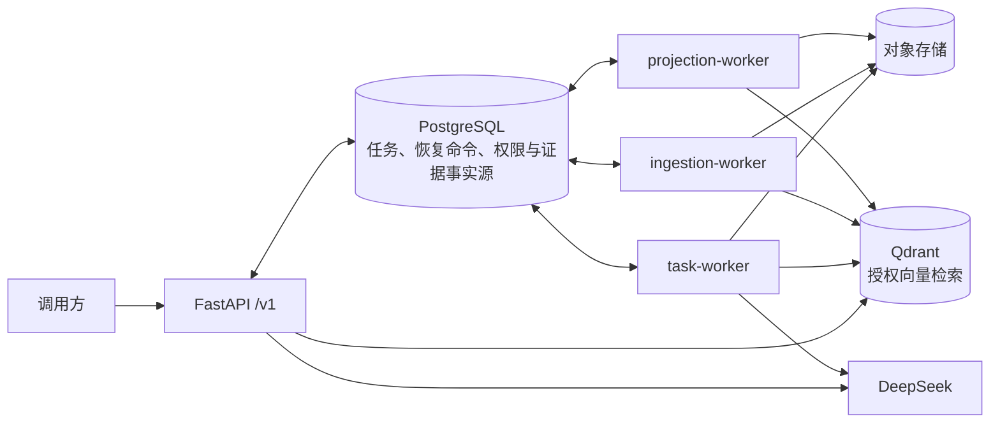

# RAG 企业知识任务智能体

[](https://github.com/LilBin85/rag-enterprise-kb/actions/workflows/tests.yml)
[](https://github.com/LilBin85/rag-enterprise-kb/actions/workflows/integration-tests.yml)

> **一句话**：在租户与 ACL 隔离下做文档摄取、证据检索、只读研究与 **HITL 受控写入**的可恢复 Agent 服务 —— PostgreSQL 是唯一事实源，Qdrant 只是可重建投影，模型无法传递权限、无法自造引用、无法跳过审批。

**为什么不是普通 RAG Demo**：多数 RAG 项目停在「检索 + 生成」。这个项目多做了一层 —— **当 Agent 要写东西时怎么办**：工具面固定、写操作必须人工审批、进程崩溃可恢复、任何失败都不能产生半截数据。为此实现了租约 fencing、checkpoint 恢复、审批绑定与证据账本，并用 690 项测试 + 17 项故障矩阵验证。

---

## 30 秒看懂

| 维度 | 实测（固定版本，可复核） |
|---|---|
| 自动化测试 | **690 通过 / 0 失败 / 0 错误 / 0 跳过**（392 s，2026-09-13）→ [`docs/acceptance/junit-690-20260913.xml`](docs/acceptance/junit-690-20260913.xml) |
| 故障恢复 | **17 项 PostgreSQL 故障矩阵全通过** → [`docs/acceptance/fault-matrix-20260913.xml`](docs/acceptance/fault-matrix-20260913.xml) |
| 检索质量 | 26 例数据集（4 开发 / 8 选参 / 14 留出）：留出集 **Recall@5 = 1.00、MRR = 1.00、ACL 泄漏率 = 0**，选参不使用留出集标签 |
| 受控写验收 | M2 隔离验收 **31 个任务 / 21 类场景**：29 个审批拒绝任务写入 **0** 次、批准路径写入 **1** 次、3 类崩溃窗口全部恢复 |
| 规模 | 12 个容器服务 · 3 类独立 Worker · 328 个受版本控制文件 · 91 次提交 |

> 测试数字有两个时点：`docs/acceptance/latest.json` 记录的是 **2026-09-07 的 598 通过**；**2026-09-13 的 690 通过**原始 JUnit XML 存于 `data/local/resume-retest-20260913/`（本地数据目录不入库），已复制到 `docs/acceptance/` 供查阅。本 README 引用较新的 690，两个时点都保留可查。

---

## 架构



交互式架构图：[系统架构总览](docs/diagrams/rag-system.architecture.html) · [同步问答](docs/diagrams/fast-query.workflow.html) · [文档摄取](docs/diagrams/document-ingestion.workflow.html) · [Durable Agent](docs/diagrams/durable-agent.workflow.html)

### 三条不可协商的设计原则

1. **PostgreSQL 是唯一事实源**：任务、恢复命令、权限、证据账本全在 SQL，可用事务审计。Qdrant 只是「可重建、可收敛」的检索投影，删了能重建。
2. **模型边界由服务端决定**：Agent 只能读服务端注入的运行上下文，无法传递 tenant / 权限 / 租约 / 批准 / 存储路径。
3. **队列不引入新中间件**：claim / lease / fencing 全部由 PostgreSQL 承担，没有 Redis、Celery、Kafka。

---

## 四个关键设计（面试常被追问的部分）

### 1. 统一入口 + 双执行路径

`EnterpriseRetriever` 是唯一 Retrieval Core，Fast Path 与 Durable Path 共用同一套授权、hybrid、阈值、重排配置，但**不共享任务生命周期与响应语义**。

| 场景 | 路径 | 返回 |
|---|---|---|
| 单问题、低步骤、无需澄清/审批 | Fast Path：`POST /v1/conversations/{id}/messages` → 检索 → 受约束生成 + 引用复核 | JSON `200` 或 SSE `200` 至 `done` |
| 多文档研究、版本比较、澄清、审批、受控写 | Durable Path：同一入口 → PostgreSQL task → task-worker/Agent → Durable 证据账本 | `202` 接受，结果异步读 |

### 2. 四个写边界全部受租约 fencing

失租方的任何写入都被拒绝，且新增业务数据为 0：

| 写边界 | 保护机制 |
|---|---|
| checkpoint 写入 | 同事务 `FOR UPDATE` 复核 `lease_owner` / `lease_generation` / 数据库时钟 |
| 工具完成提交 | 同一事务绑定租约复核，旧 Worker 只能拿到 stale |
| 幂等回放 | 身份快照指纹绑定，身份变化返回 `task_auth_context_changed` |
| 最终任务提交 | `finish_task()` 行锁内用 `clock_timestamp()` 终检状态、取消与 deadline |

### 3. HITL 审批 + 六种失效情形

「模型提议 → 人工暂停 → 服务端审批绑定 → 恢复执行 → 幂等落库」，审批绑定到**具体工具、参数摘要、证据快照、checkpoint**。

`test_invalidated_approval_never_executes_adapter` 参数化覆盖六种失效，任一命中都不执行写操作：

```
expiry            审批过期
principal_changed 审批主体变更
acl_revoked       权限被撤销
evidence_withdrawn 证据被撤回
arguments_drift   参数漂移（审批后被改）
version_drift     文档版本漂移
```

### 4. Qdrant 三阶段投影

`构建（indexing）` → `发布（active/current，但 SQL 仍绑旧世代）` → `绑定并退役（单事务 CAS 激活新绑定）`。
**先发布后绑定**，切换窗口内只返回旧绑定，避免读到半成品；清理失败不回滚 SQL 绑定，由周期审计收敛。

---

## 快速开始

### A. 只想读代码（5 分钟）

| 目标 | 看这里 |
|---|---|
| 系统边界与两路径分流 | [`docs/architecture.md`](docs/architecture.md)（1–78 行，一次读完） |
| 权威数字与验收门禁 | [`docs/acceptance/latest.json`](docs/acceptance/latest.json) 的 `verdict` / `gates` / `quality` |
| 工程约束与安全边界 | [`docs/threat-model.md`](docs/threat-model.md) · [`docs/observability-plan.md`](docs/observability-plan.md) |
| 演进过程与当前停止点 | [`docs/project-evolution.md`](docs/project-evolution.md) |

### B. 想跑起来（15 分钟）

前置：Docker Desktop 已启动；`.env` 已配置 `DEEPSEEK_API_KEY`、`DEMO_ROLE_TOKENS` 和本地 BGE-M3 缓存（首次需下载模型）。

```powershell
docker compose up --build -d
```

就绪后：浏览器工作台 `http://localhost:5173` 或 Swagger `http://localhost:8000/docs`，按「初始化身份 → 上传文档 → 等待摄取 → 提问」走一遍；健康检查 `GET /health/ready`。

带可观测性栈（Grafana / Jaeger / Prometheus，仅绑定 127.0.0.1）：

```powershell
docker compose --profile observability up --build -d
# Grafana :3000 · Jaeger :16686 · Prometheus :9090
```

> 观测配置不采集请求、正文、Prompt、模型输出或工具 payload。

### C. 想复现验收（需要本机 PostgreSQL + Qdrant）

```powershell
cd backend
python -m pytest -q                                  # 全量回归
cd ..
python backend/scripts/benchmark_enterprise_retrieval.py `
  --dataset data/benchmarks/retrieval_acceptance_v2.yaml `
  --schema backend/schemas/retrieval-acceptance-v2.schema.json `
  --output data/local/benchmarks/retrieval-check.json
python backend/scripts/build_project_acceptance_report.py `
  --pytest-xml <pytest.xml> --retrieval-report data/local/benchmarks/retrieval-check.json `
  --m1-e2e-report docs/acceptance/m1-research-e2e.json `
  --m2-e2e-report docs/acceptance/m2-controlled-write-e2e.json `
  --dataset data/benchmarks/retrieval_acceptance_v2.yaml `
  --config backend/pyproject.toml --output docs/acceptance/latest.json
```

> **已知缺口（诚实说明）**：目前是 3 条命令而非一条 `make accept`，一键验收脚本在计划中。报告脚本不会从文档继承指标，也不填充缺失数字 —— 没有实测的项会明确标 `missing`。

无 Docker 的 Windows/Conda 启动方式见文末[附录](#附录windowsconda-启动)。

---

## 目录结构

```text
backend/
├── src/rag_kb/          # 应用：agent / application / domain / infrastructure / web / evaluation
├── tests/               # 82 个测试文件，按域分层（含 postgres 故障矩阵）
├── migrations/          # Alembic
├── scripts/             # 可复现入口：benchmark / smoke e2e / acceptance report / 诊断
└── schemas/             # 机器契约（JSON Schema）
frontend/                # React + TypeScript 工作台
ops/observability/       # OTel collector + Prometheus 规则 + Grafana 看板
docs/                    # 架构 / 迁移 / 威胁模型 / 可观测性 / 演进 + acceptance 报告
data/benchmarks/         # 检索与任务数据集
deliverables/            # 架构图 HTML（可交互）与面试学习材料
```

## 已知边界（不粉饰）

| 边界 | 说明 |
|---|---|
| 部署形态 | 本地/单机 Docker Compose，**不是** K8s 集群、没有多机高可用 |
| 扫描件 | Docling 显式 `do_ocr=False`，只支持数字原生文本层 PDF；扫描件解析为空并以 `document_parse_empty` 失败关闭 |
| 检索样本 | 26 例（留出 14 例），场景限定企业制度文档；证据门偏保守，宁拒答不误答 |
| 当前验收配置 | `latest.json` 的检索门以 **dense-only** 通过；hybrid + reranker 后来才默认开启，未在同一份报告里重跑 |
| 引用能力边界 | 引用复核能挡「编造出处」，挡不住「引用真实片段却写错数字」，后者由离屏评测 `rag_kb.evaluation.answer_quality` 度量 |
| Agent 范围 | M2 停止在 2 个固定 WRITE adapter，不进入多 Agent、MCP、长期记忆、外部写入 |

## 文档索引

- [架构说明](docs/architecture.md) —— 权威设计文档（事实源、双路径、三阶段投影、四条 fencing、工具面）
- [威胁模型](docs/threat-model.md) —— 权限与数据边界
- [可观测性方案](docs/observability-plan.md) —— 指标、追踪、看板、告警
- [迁移说明](docs/migration.md) —— 目录与迁移约束
- [项目演进摘要](docs/project-evolution.md) —— 从 RAG 到 Durable Agent 的收敛过程与停止点

> 本地演示的逐步操作说明（身份初始化、令牌轮换、审批操作）在仓库外的《使用指南》，不随代码分发。

## API 概览

| 接口 | 说明 |
|---|---|
| `POST /v1/conversations` · `GET /v1/conversations/{id}/messages` · `DELETE /v1/conversations/{id}` | 统一会话的创建、历史、异步删除 |
| `POST /v1/conversations/{id}/messages` | **唯一**公开消息入口，必须带 `Idempotency-Key`；`kind:new` 可选 `auto/answer/research/controlled_action` |
| `POST /v1/documents` · `POST /v1/documents/{id}/versions` | 上传首版 / 新版本（multipart，带幂等键，返回 202） |
| `GET /v1/tasks/{id}` · `/result` · `/events` · `/cancel` | 受控任务读取与取消 |
| `GET /v1/approvals` · `POST /v1/approvals/{id}/decision` | 审批发现与决策（幂等，相反决定返回 409） |

身份来自 `Authorization: Bearer` 或本地演示 `X-Demo-Role-Token`，**角色不能由请求正文提升**。`202` 仅表示任务已耐久提交到 PostgreSQL，不代表 Agent 已执行；只有 `task-worker` 能领取任务并构造执行载荷。

---

## 附录：Windows/Conda 启动

前置：Conda 环境 `rag-kb`、PostgreSQL、Qdrant（默认 `http://localhost:6333`）。**不要把密钥写入仓库**。

```powershell
conda activate rag-kb
docker compose up -d qdrant
$env:RAG_KB_DATABASE_URL = "postgresql+psycopg://<用户>:<密码>@localhost:5432/<数据库>"
cd backend; alembic upgrade head; cd ..
python backend/scripts/init_agent_checkpointer.py
python -m rag_kb.qdrant_init
.\backend\scripts\start_api.ps1
# 三个 Worker 必须在独立终端分别常驻，没有「轮询所有队列」模式
.\backend\scripts\start_worker.ps1 -Queue task
.\backend\scripts\start_worker.ps1 -Queue ingestion
.\backend\scripts\start_worker.ps1 -Queue projection
```

| Worker | 职责 | 是否需模型配置 |
|---|---|---|
| `task-worker` | Agent 初始任务、澄清/审批恢复、发布 `task-agent/m2-fenced-v1` capability、任务保留 | 需要 |
| `ingestion-worker` | 文档解析、embedding、索引、上传预留恢复 | 不需要 |
| `projection-worker` | Qdrant 投影收敛、周期审计、修复重建 | 不需要 |

`GET /health/ready` 只检查 PostgreSQL、Alembic revision、Qdrant、collection schema、活动投影收敛，**不检查任一 Worker**；因此 task-worker 挂了普通问答仍可用，只是新建 durable task 会在 capability lease 到期后返回 503。

---

## 目录边界说明

`backend/src/rag_kb/` 为新应用；`backend/tests/` 为分层回归；`backend/schemas/` 为机器契约；`backend/scripts/` 为可复现入口；`data/benchmarks/` 为任务集。`.obsidian/`、`output/`、面试材料与历史验收报告属受保护资产，不在迁移中删除或覆盖。E2E 结束后必须清理临时 PostgreSQL 库、专属 Qdrant collection 与对象目录；正式机器证据为 `docs/acceptance/m1-research-e2e.json`、`docs/acceptance/m2-controlled-write-e2e.json`、`docs/acceptance/latest.json`。
