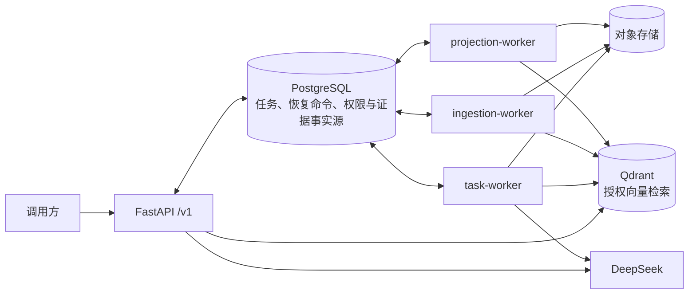

# RAG 企业知识任务智能体

[](https://github.com/LilBin85/rag-enterprise-kb/actions/workflows/tests.yml)
[](https://github.com/LilBin85/rag-enterprise-kb/actions/workflows/integration-tests.yml)

一个面向企业制度与技术规范的可审计 RAG/Agent 服务：在租户与 ACL 隔离下完成文档摄取、证据检索、只读研究和 HITL 受控写入，并提供本地 React/Vite 浏览器工作台。

## 架构



交互式图：[系统架构总览](deliverables/rag-interview-study/diagrams/rag-system.architecture.html) · [同步知识问答](deliverables/rag-interview-study/diagrams/fast-query.workflow.html) · [文档摄取](deliverables/rag-interview-study/diagrams/document-ingestion.workflow.html) · [Durable Agent](deliverables/rag-interview-study/diagrams/durable-agent.workflow.html)

PostgreSQL 是任务、恢复命令和权限状态的唯一事实源，Qdrant 只是可重建、可收敛的检索投影；Agent 身份、工具和审批绑定均由服务端注入。队列继续由 PostgreSQL claim/lease/fencing 驱动，没有新增 Redis、Celery、Kafka 或其他消息中间件。

## Fast Path 与 Durable Path

`EnterpriseRetriever` 是唯一共享 Retrieval Core。它由 infrastructure factory 以同一组授权、Qdrant、BGE、候选/上下文限制、RRF、hybrid、阈值、重排和证据充分性配置装配；多路召回与重排默认开启，重排失败回落融合顺序。两条路径只共享检索事实，不合并任务生命周期或响应语义。

| 场景 | 选择 | 时序 | 返回 |
| --- | --- | --- | --- |
| 单问题、低步骤数、无需澄清或审批 | 统一会话的快速执行器 | `POST /v1/conversations/{id}/messages` → 会话路由 → Retrieval Core → 受约束回答与 citation 复核 | JSON `200`，或 SSE `200` 直至 `done` |
| 多文档研究、版本比较、澄清、审批或受控写入 | 统一会话的耐久智能体 | 同一消息入口 → PostgreSQL task → task-worker/Agent → Retrieval Core → Durable evidence ledger | 接受返回 `202`，结果异步读取 |

Fast Path 不依赖 task-worker capability；Durable Path 保留 Agent、工具预算、checkpoint 与 HITL。检索 telemetry 仅用固定 `retrieval_consumer=fast|durable` 区分消费者，不记录 query、task、tenant 或 user 标签。

## 三分钟演示

前置：Docker Desktop 已启动，`.env` 已配置 `DEEPSEEK_API_KEY`、`DEMO_ROLE_TOKENS` 和本地 BGE-M3 缓存。已有镜像和模型缓存时，只需一条命令：

```powershell
docker compose up --build -d
```

服务就绪后可打开 [浏览器工作台](http://localhost:5173) 或 [Swagger 操作页](http://localhost:8000/docs)，按“初始化身份 → 上传文档 → 等待摄取成功 → 提问”完成演示；逐步说明见[使用指南](使用指南.md)，健康状态见 [`/health/ready`](http://localhost:8000/health/ready)。

浏览器工作台位于 [`frontend/`](frontend/README.md)：后端就绪后执行 `cd frontend; npm install; npm run dev`，打开 `http://localhost:5173` 即可用演示令牌完成文档上传、流式问答、任务查看和独立审批。`answer.preview` 仅是未校验草稿，`done` 的正式答案与 citations 才是权威结果。

## 核心指标

| 验收项 | 固定版本实测结果 |
| --- | ---: |
| 自动化测试 | 598 / 598 通过，0 失败，0 跳过 |
| 检索质量 | Recall@5 = 1.00，MRR = 1.00，无答案准确率 = 1.00 |
| 权限隔离 | ACL 泄漏率 = 0 |
| M1 只读 Research Agent | 通过；4 次工具调用，5 条引用 |
| M2 受控写入 | 通过；31 个任务，21 个场景 |

数据来自机器报告 [docs/acceptance/latest.json](docs/acceptance/latest.json)，当前绑定最近一次受验收的生产代码版本 `9361c8c`。报告固化及后续纯文档或仓库维护提交可以拥有更新的 HEAD，但不会扩大该报告的验收范围；任何生产代码改动后都必须重新生成报告，并以 `verdict`、`gates` 和检索质量门为准。

## 三个关键技术取舍

| 取舍 | 得到什么 | 付出什么 |
| --- | --- | --- |
| PostgreSQL 作为唯一事实源 | 状态、授权、证据和恢复语义可事务化审计 | 迁移与事务边界更严格 |
| Qdrant 作为带世代的授权投影 | 避免旧向量和越权结果进入答案 | 摄取需要构建、校验、切换和收敛 |
| 固定工具集 + HITL + checkpoint | Agent 可恢复，写操作可审批、可追责 | 比无约束同步 Agent 延迟更高、流程更长 |

详细边界见[架构说明](docs/architecture.md)、[威胁模型](docs/threat-model.md)和[迁移说明](docs/migration.md)。项目从 RAG 到 Durable Agent 的收敛过程及当前技术边界见[项目演进摘要](docs/project-evolution.md)。

## Windows 启动

前置：Conda 环境 `rag-kb`、PostgreSQL、Qdrant（默认 `http://localhost:6333`）。不要把密钥写入仓库；`.env` 仅供本地配置读取。

完整容器方式会启动 PostgreSQL、Qdrant、迁移、一次性 `qdrant-init`、API 和三个独立 Worker。
启动前应在 `.env` 中把 `DEMO_ROLE_TOKENS` 配置为 JSON 令牌映射；未配置时健康检查可用，
受保护接口固定拒绝未认证请求：

```powershell
docker compose up --build -d
```

本地演示完整观测链路时，改用以下命令。Grafana、Jaeger 和 Prometheus 仅绑定到
`127.0.0.1`；三个 Worker 的 `:9464`、`:9465`、`:9466` 指标端口只在 Compose 网络内供 Prometheus 抓取。

```powershell
docker compose --profile observability up --build -d
```

入口：Grafana `http://127.0.0.1:3000`、Jaeger `http://127.0.0.1:16686`、Prometheus
`http://127.0.0.1:9090`。观测配置不采集请求、正文、Prompt、模型输出或工具 payload。

本机未安装 Docker 时可使用下面的 Windows/Conda 方式：

```powershell
conda activate rag-kb
docker compose up -d qdrant
$env:RAG_KB_DATABASE_URL = "postgresql+psycopg://<用户>:<密码>@localhost:5432/<数据库>"
# Alembic 在后端工程目录运行（alembic.ini 位于 backend/）
cd backend
alembic upgrade head                 # 当前迁移目标：20260911_0017
cd ..
python backend/scripts/init_agent_checkpointer.py
python -m rag_kb.qdrant_init         # 幂等创建并校验企业 Qdrant schema
.\backend\scripts\start_api.ps1     # FastAPI :8000
conda run -n rag-kb --no-capture-output python -m rag_kb.worker --queue task --watch
conda run -n rag-kb --no-capture-output python -m rag_kb.worker --queue ingestion --watch
conda run -n rag-kb --no-capture-output python -m rag_kb.worker --queue projection --watch
```

三个命令需要分别在独立终端中持续运行；也可分别执行 `.\backend\scripts\start_worker.ps1 -Queue task`、`.\backend\scripts\start_worker.ps1 -Queue ingestion` 和 `.\backend\scripts\start_worker.ps1 -Queue projection`。不存在默认轮询全部队列的模式。

| Worker | 职责与配置边界 |
| --- | --- |
| `task-worker` | 执行 Agent 初始任务、用户澄清恢复和审批恢复，发布 `task-agent/m2-fenced-v1` capability，收敛 task/tool/knowledge-query 超时和 task retention，并维护任务队列指标；需要 DeepSeek 配置。 |
| `ingestion-worker` | 解析文档、生成 embedding、写入索引、恢复上传预留并维护摄取队列指标；不需要 DeepSeek 配置。 |
| `projection-worker` | 执行 Qdrant 投影收敛、周期审计、修复与重建；不需要 DeepSeek 配置。 |

`GET /health/ready` 当前只检查 PostgreSQL、Alembic schema revision、Qdrant、Qdrant collection schema 和活动投影收敛状态，不直接检查任一 Worker。Worker 缺失的实际影响如下：

| 缺失服务 | 实际影响 |
| --- | --- |
| `task-worker` | capability lease 到期后，通过会话消息提交的 `research` 或 `controlled_action` 返回 `503`；已有任务和恢复命令继续保留在 PostgreSQL 中等待消费；普通 `answer` 不依赖 Agent Worker。 |
| `ingestion-worker` | 上传仍可能返回 `202`，但摄取任务积压，文档长期停在 `pending`。 |
| `projection-worker` | 周期投影审计和修复停止；只有活动投影实际不收敛时，`projection_convergence` 才会使 readiness 失败。 |

若本机没有 Docker，可由管理员单独启动 PostgreSQL/Qdrant；不要在 API 进程中执行迁移或下载模型。健康检查：`GET /health/live` 与 `GET /health/ready`。

2026-08-23 已完成本机 Docker Compose 真实构建、迁移、Qdrant 初始化、服务健康和 HTTP
认证边界验证；其他环境必须重新运行健康检查，不能直接继承本机结论。

## API

- `POST /v1/conversations`、`GET /v1/conversations`、`GET /v1/conversations/{conversation_id}`、`GET /v1/conversations/{conversation_id}/messages`、`DELETE /v1/conversations/{conversation_id}`：统一会话的创建、读取、历史和异步删除。
- `POST /v1/conversations/{conversation_id}/messages`：唯一公开的用户消息入口，必须带 `Idempotency-Key`；`new` 消息可选择 `auto|answer|research|controlled_action`，并可通过 `scope_document_id` 将本轮硬限制在一份当前有权读取的文档内；省略时仍检索全部授权文档。`clarification` 必须绑定既有 turn/task/version。普通 JSON 客户端的快速回答返回 `200`；请求 `Accept: text/event-stream` 时，普通问答以 SSE 返回 `turn.accepted`、`status`、`answer.preview` 和最终 `done` 事件，耐久任务仍返回 `202` JSON。
- `POST /v1/documents`：multipart 上传新文档，必须带 `Idempotency-Key`，返回 `202`。
- `POST /v1/documents/{document_id}/versions`：上传同一文档的新版本；路径和 metadata 的 `document_id` 必须一致，并使用新的 `Idempotency-Key`。
- `GET /v1/documents/{document_id}`、`GET /v1/ingestion-jobs/{job_id}`：租户与 ACL 约束的查询。
- `GET /v1/tasks/{task_id}`、`GET /v1/tasks/{task_id}/result`、`GET /v1/tasks/{task_id}/events`、`GET /v1/tasks/{task_id}/artifacts/{artifact_id}/content` 与 `POST /v1/tasks/{task_id}/cancel` 保留为受控任务读取/取消接口；任务响应可关联其 `conversation_id` 与 `turn_id`。
- `GET /v1/approvals`、`GET /v1/approvals/{approval_id}`、`POST /v1/approvals/{approval_id}/decision`：仅 `task:approve` 审批者可发现和决定待审批动作；决定成功返回 `202 Accepted`，同一决定重试保持幂等，相反决定返回稳定 `409` 冲突。
- `GET /v1/tasks/{task_id}/artifacts/{artifact_id}/content`：仅任务 owner 且拥有 `task:read` 时读取正文；未就绪为 `409`、过期或已清理为 `410`、完整性失败为 `500`，响应不暴露对象键或文件元数据。

身份来自 `Authorization: Bearer ...` 或本地演示 `X-Demo-Role-Token`，角色不能由请求正文提升。本地演示主体的初始化请运行 `python backend/scripts/init_demo_principals.py`，它按令牌真实解析的 permissions attributes 写入，不要手工插入空 attributes 的记录。轮换本地令牌后运行该脚本并重建 `api`，详情见[使用指南](使用指南.md#令牌轮换或新增审批者)。应用只提供版本化 `/v1` 业务接口。

会话消息的 `202` 只表示 API 已完成认证、授权、版本校验并把耐久任务提交到 PostgreSQL，不表示 Agent、工具或任务已经同步完成。API 不构造 LangGraph `Command`、不运行 Agent、也不执行工具；只有 `task-worker` 能领取任务、重新校验服务端绑定并构造服务端执行载荷。Worker 暂时离线不会撤销已提交任务；响应不暴露内部执行绑定。

### 破坏性升级：统一会话入口

`POST /v1/knowledge/query`、`POST /v1/tasks` 和 `POST /v1/tasks/{task_id}/continue` 已移除，不提供兼容代理。调用方应先创建会话，再通过 `POST /v1/conversations/{conversation_id}/messages` 提交 `new` 或绑定任务版本的 `clarification` 消息；请保存返回的 conversation、turn 与 task 标识。

## 验证

GitHub Actions 将普通测试与 PostgreSQL/Qdrant 集成测试拆成两条流水线，并分别上传 JUnit 报告；60 例离线任务评测报告见 [docs/acceptance/enterprise-task-evaluation.json](docs/acceptance/enterprise-task-evaluation.json)。

```powershell
# 后端测试在后端工程目录 backend/ 下运行
cd backend
conda run -n rag-kb --no-capture-output python -m pytest -q `
  tests/test_database_migrations.py `
  tests/test_agent_checkpointer.py `
  tests/test_task_agent.py `
  tests/test_task_worker_recovery.py `
  tests/test_v1_documents_api.py

conda run -n rag-kb --no-capture-output python -m pytest -q

# 对现有数据执行只读检索诊断；输出不含令牌、查询正文或证据正文
conda run -n rag-kb --no-capture-output python scripts/diagnose_retrieval.py `
  --query "差旅报销上限是多少？" `
  --role employee `
  --document-id "travel-policy"

# 仅在 RAG_KB_TEST_POSTGRES_URL 已配置且 Qdrant 可达时运行
conda run -n rag-kb --no-capture-output python -m pytest -q `
  tests/test_postgres_agent_checkpointer.py `
  tests/test_postgres_qdrant_projection_convergence.py
cd ..

# 真实模型验证：先创建独立 PostgreSQL 数据库、m1_e2e_ 前缀的 Qdrant collection
# 和独立对象目录；执行结束后删除这些临时资源。环境变量 LANGGRAPH_STRICT_MSGPACK=true
# 会同时启用 LangGraph 运行时 allowlist 与 schema 推导白名单；脚本还会核验
# checkpoint serializer 的 pickle_fallback=false 并拒绝 pickle 编码落库。
# 以下脚本均从仓库根运行。
$env:LANGGRAPH_STRICT_MSGPACK = "true"
conda run -n rag-kb --no-capture-output python backend/scripts/smoke_m1_research_e2e.py `
  --allow-live `
  --database-url "postgresql+psycopg://<用户>:<密码>@localhost:5432/<临时数据库>" `
  --qdrant-url "http://localhost:6333" `
  --qdrant-collection "m1_e2e_<唯一标识>" `
  --object-store-root "data/local/e2e/m1_e2e_<唯一标识>" `
  --hf-home "$env:HF_HOME" `
  --previous-source "data/corpus/sources/员工休假制度-v1.md" `
  --source "data/corpus/sources/员工休假制度-v2.md" `
  --report "docs/acceptance/m1-research-e2e.json"

conda run -n rag-kb --no-capture-output python backend/scripts/benchmark_enterprise_retrieval.py `
  --dataset data/benchmarks/retrieval_acceptance_v2.yaml `
  --schema backend/schemas/retrieval-acceptance-v2.schema.json `
  --output data/local/benchmarks/enterprise-retrieval-stage9-sufficiency-aligned.json
conda run -n rag-kb --no-capture-output python backend/scripts/build_project_acceptance_report.py `
  --pytest-xml data/local/acceptance/pytest-stage9.xml `
  --retrieval-report data/local/benchmarks/enterprise-retrieval-stage9-sufficiency-aligned.json `
  --m1-e2e-report docs/acceptance/m1-research-e2e.json `
  --m2-e2e-report docs/acceptance/m2-controlled-write-e2e.json `
  --dataset data/benchmarks/retrieval_acceptance_v2.yaml `
  --config backend/pyproject.toml `
  --output docs/acceptance/latest.json
```

报告中记录的 M1/M2 严格真实 E2E 曾在隔离资源上通过：M1 验证 V1/V2 上传、精确四个 READ 工具与结果引用；M2 验证 31 个受控任务、HITL、批准/拒绝、artifact 隔离、恢复窗口、严格 msgpack 与终态审计。其固定版本全量回归为 `598 passed / 0 failed / 0 skipped`，不是后续工作树结论；脚本不会从文档继承指标或填充缺失数字。

## 目录边界

`backend/src/rag_kb/` 为新应用；`backend/tests/` 为分层回归；`backend/schemas/` 为机器契约；`backend/scripts/` 为可复现入口；`data/benchmarks/` 为任务集。用户的 `.obsidian/`、`output/`、面试材料和历史验收报告均属于受保护资产，不在迁移中删除或覆盖。E2E 结束后，调用方必须删除本次创建的临时 PostgreSQL 数据库、专属 Qdrant collection 和对象目录；正式机器证据为 `docs/acceptance/m1-research-e2e.json`、`docs/acceptance/m2-controlled-write-e2e.json` 与 `docs/acceptance/latest.json`。
