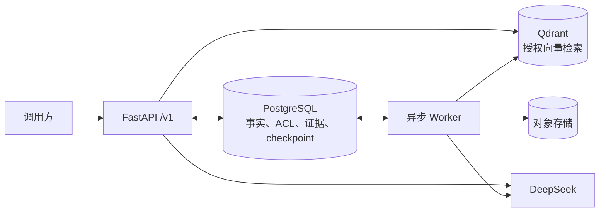

# RAG 企业知识任务智能体

一个面向企业制度与技术规范的可审计 RAG/Agent 后端：在租户与 ACL 隔离下完成文档摄取、证据检索、只读研究和 HITL 受控写入。

## 架构



PostgreSQL 是唯一事实源，Qdrant 只是可重建、可收敛的检索投影；Agent 身份、工具和审批绑定均由服务端注入。

## 三分钟演示

前置：Docker Desktop 已启动，`.env` 已配置 `DEEPSEEK_API_KEY`、`DEMO_ROLE_TOKENS` 和本地 BGE-M3 缓存。已有镜像和模型缓存时，只需一条命令：

```powershell
docker compose up --build -d
```

服务就绪后打开 [Swagger 操作页](http://localhost:8000/docs)，按“初始化身份 → 上传文档 → 等待摄取成功 → 提问”完成演示；逐步说明见[使用指南](使用指南.md)，健康状态见 [`/health/ready`](http://localhost:8000/health/ready)。

## 核心指标

| 验收项 | 固定版本实测结果 |
| --- | ---: |
| 自动化测试 | 528 / 528 通过，0 失败，0 跳过 |
| 检索质量 | Recall@5 = 1.00，MRR = 1.00，无答案准确率 = 1.00 |
| 权限隔离 | ACL 泄漏率 = 0 |
| M1 只读 Research Agent | 通过；4 次工具调用，3 条引用 |
| M2 受控写入 | 通过；31 个任务，21 个场景 |

数据来自机器报告 [docs/acceptance/latest.json](docs/acceptance/latest.json)，绑定代码版本 `af0e94e`；它是固定版本快照，不自动代表后续工作树已通过。发布前必须重新生成报告，并以 `verdict`、`gates`、`unverified` 和检索质量门为准。

## 三个关键技术取舍

| 取舍 | 得到什么 | 付出什么 |
| --- | --- | --- |
| PostgreSQL 作为唯一事实源 | 状态、授权、证据和恢复语义可事务化审计 | 迁移与事务边界更严格 |
| Qdrant 作为带世代的授权投影 | 避免旧向量和越权结果进入答案 | 摄取需要构建、校验、切换和收敛 |
| 固定工具集 + HITL + checkpoint | Agent 可恢复，写操作可审批、可追责 | 比无约束同步 Agent 延迟更高、流程更长 |

详细边界见[架构说明](docs/architecture.md)、[威胁模型](docs/threat-model.md)和[迁移说明](docs/migration.md)。

## Windows 启动

前置：Conda 环境 `rag-kb`、PostgreSQL、Qdrant（默认 `http://localhost:6333`）。不要把密钥写入仓库；`.env` 仅供本地配置读取。

完整容器方式会启动 PostgreSQL、Qdrant、迁移、一次性 `qdrant-init`、API 和 worker。
启动前应在 `.env` 中把 `DEMO_ROLE_TOKENS` 配置为 JSON 令牌映射；未配置时健康检查可用，
受保护接口固定拒绝未认证请求：

```powershell
docker compose up --build -d
```

本地演示完整观测链路时，改用以下命令。Grafana、Jaeger 和 Prometheus 仅绑定到
`127.0.0.1`；Worker 的 `:9464/metrics` 只在 Compose 网络内供 Prometheus 抓取。

```powershell
docker compose --profile observability up --build -d
```

入口：Grafana `http://127.0.0.1:3000`、Jaeger `http://127.0.0.1:16686`、Prometheus
`http://127.0.0.1:9090`。观测配置不采集请求、正文、Prompt、模型输出或工具 payload。

本机未安装 Docker 时可使用下面的 Windows/Conda 方式：

```powershell
conda activate rag-kb
docker compose up -d qdrant
$env:RAG_KB_DATABASE_URL = "postgresql+psycopg://<用户>:<密码>@localhost:5432/<数据库>"
alembic upgrade head                 # 当前迁移目标：20260829_0014
python scripts/init_agent_checkpointer.py
python -m rag_kb.qdrant_init         # 幂等创建并校验企业 Qdrant schema
.\scripts\start_api.ps1             # FastAPI :8000
conda run -n rag-kb --no-capture-output python -m rag_kb.worker --watch --include-tasks
```

`--include-tasks` 同时启用通用任务队列、过期工具调用和同步问答租约回收；摄取、投影收敛和上传预留恢复始终由 worker 处理。

若本机没有 Docker，可由管理员单独启动 PostgreSQL/Qdrant；不要在 API 进程中执行迁移或下载模型。健康检查：`GET /health/live` 与 `GET /health/ready`。

2026-08-23 已完成本机 Docker Compose 真实构建、迁移、Qdrant 初始化、服务健康和 HTTP
认证边界验证；其他环境必须重新运行健康检查，不能直接继承本机结论。

## API

- `POST /v1/knowledge/query`：服务端身份问答。
- `POST /v1/documents`：multipart 上传新文档，必须带 `Idempotency-Key`，返回 `202`。
- `POST /v1/documents/{document_id}/versions`：上传同一文档的新版本；路径和 metadata 的 `document_id` 必须一致，并使用新的 `Idempotency-Key`。
- `GET /v1/documents/{document_id}`、`GET /v1/ingestion-jobs/{job_id}`：租户与 ACL 约束的查询。
- `POST /v1/tasks` 接受 `research` 与 `controlled_action`；后者还要求 feature gate 开启和兼容 Worker lease。`GET /v1/tasks/{task_id}/result` 返回服务端重验的结果；`/continue` 只恢复服务端确认的澄清 interrupt。
- `GET /v1/approvals`、`GET /v1/approvals/{approval_id}`、`POST /v1/approvals/{approval_id}/decision`：仅 `task:approve` 审批者可发现和决定待审批动作；服务端构造 resume，重复同一决定幂等，相反决定返回 `409`。
- `GET /v1/tasks/{task_id}/artifacts/{artifact_id}/content`：仅任务 owner 且拥有 `task:read` 时读取正文；未就绪为 `409`、过期或已清理为 `410`、完整性失败为 `500`，响应不暴露对象键或文件元数据。

身份来自 `Authorization: Bearer ...` 或本地演示 `X-Demo-Role-Token`，角色不能由请求正文提升。本地演示主体的初始化请运行 `python scripts/init_demo_principals.py`，它按令牌真实解析的 permissions attributes 写入，不要手工插入空 attributes 的记录。应用只提供版本化 `/v1` 业务接口。

## 验证

GitHub Actions 将普通测试与 PostgreSQL/Qdrant 集成测试拆成两条流水线，并分别上传 JUnit 报告；60 例离线任务评测报告见 [docs/acceptance/enterprise-task-evaluation.json](docs/acceptance/enterprise-task-evaluation.json)。

```powershell
conda run -n rag-kb --no-capture-output python -m pytest -q `
  tests/test_database_migrations.py `
  tests/test_agent_checkpointer.py `
  tests/test_task_agent.py `
  tests/test_task_worker_recovery.py `
  tests/test_v1_documents_api.py

conda run -n rag-kb --no-capture-output python -m pytest -q

# 仅在 RAG_KB_TEST_POSTGRES_URL 已配置且 Qdrant 可达时运行
conda run -n rag-kb --no-capture-output python -m pytest -q `
  tests/test_postgres_agent_checkpointer.py `
  tests/test_postgres_qdrant_projection_convergence.py

# 真实模型验证：先创建独立 PostgreSQL 数据库、m1_e2e_ 前缀的 Qdrant collection
# 和独立对象目录；执行结束后删除这些临时资源。环境变量 LANGGRAPH_STRICT_MSGPACK=true
# 会同时启用 LangGraph 运行时 allowlist 与 schema 推导白名单；脚本还会核验
# checkpoint serializer 的 pickle_fallback=false 并拒绝 pickle 编码落库。
$env:LANGGRAPH_STRICT_MSGPACK = "true"
conda run -n rag-kb --no-capture-output python scripts/smoke_m1_research_e2e.py `
  --allow-live `
  --database-url "postgresql+psycopg://<用户>:<密码>@localhost:5432/<临时数据库>" `
  --qdrant-url "http://localhost:6333" `
  --qdrant-collection "m1_e2e_<唯一标识>" `
  --object-store-root "data/local/e2e/m1_e2e_<唯一标识>" `
  --hf-home "$env:HF_HOME" `
  --previous-source "data/corpus/sources/员工休假制度-v1.md" `
  --source "data/corpus/sources/员工休假制度-v2.md" `
  --report "docs/acceptance/m1-research-e2e.json"

conda run -n rag-kb --no-capture-output python scripts/benchmark_enterprise_retrieval.py `
  --dataset data/benchmarks/retrieval_acceptance_v2.yaml `
  --schema schemas/retrieval-acceptance-v2.schema.json `
  --output data/local/benchmarks/enterprise-retrieval-stage9-sufficiency-aligned.json
conda run -n rag-kb --no-capture-output python scripts/build_project_acceptance_report.py `
  --pytest-xml data/local/acceptance/pytest-stage9.xml `
  --retrieval-report data/local/benchmarks/enterprise-retrieval-stage9-sufficiency-aligned.json `
  --m1-e2e-report docs/acceptance/m1-research-e2e.json `
  --m2-e2e-report docs/acceptance/m2-controlled-write-e2e.json `
  --dataset data/benchmarks/retrieval_acceptance_v2.yaml `
  --config pyproject.toml `
  --output docs/acceptance/latest.json
```

报告中记录的 M1/M2 严格真实 E2E 曾在隔离资源上通过：M1 验证 V1/V2 上传、精确四个 READ 工具与结果引用；M2 验证 31 个受控任务、HITL、批准/拒绝、artifact 隔离、恢复窗口、严格 msgpack 与终态审计。其固定版本全量回归为 `528 passed / 0 failed / 0 skipped`，不是后续工作树结论；脚本不会从文档继承指标或填充缺失数字。

## 目录边界

`src/rag_kb/` 为新应用；`tests/` 为分层回归；`schemas/` 为机器契约；`scripts/` 为可复现入口；`data/benchmarks/` 为任务集。用户的 `.obsidian/`、`output/`、面试材料和历史验收报告均属于受保护资产，不在迁移中删除或覆盖。E2E 结束后，调用方必须删除本次创建的临时 PostgreSQL 数据库、专属 Qdrant collection 和对象目录；正式机器证据为 `docs/acceptance/m1-research-e2e.json`、`docs/acceptance/m2-controlled-write-e2e.json` 与 `docs/acceptance/latest.json`。
